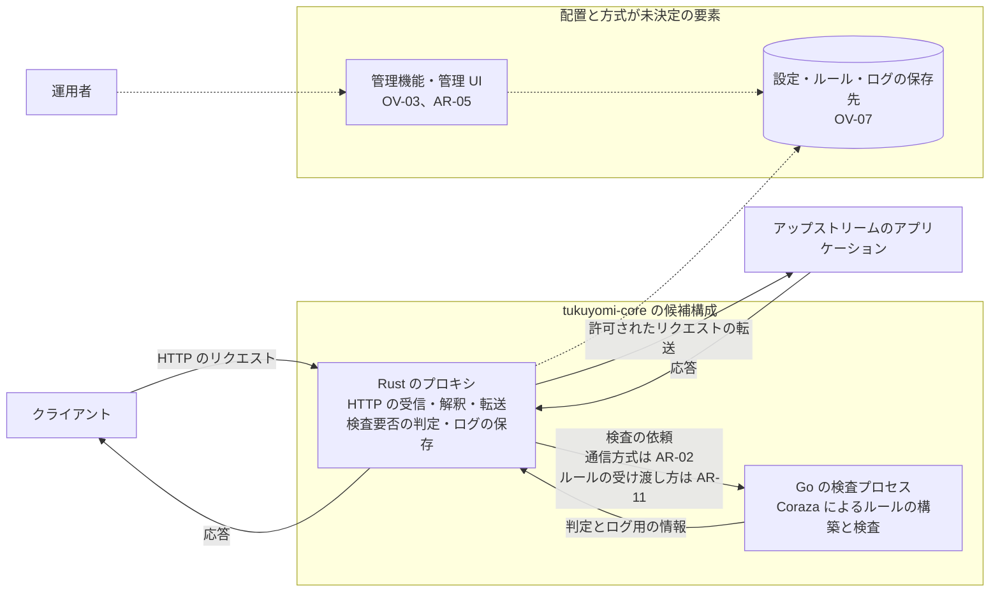
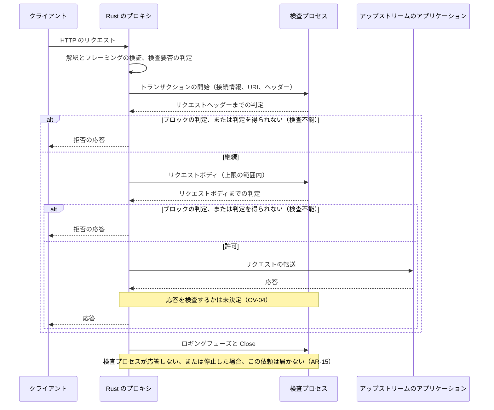

[English](architecture.md) | [日本語](architecture.ja.md)

# アーキテクチャ概要

> **状態: 初期草案**
>
> この文書は全体構成の候補を示します。
> 実装済みの範囲は、[システム概要](system-overview.ja.md) の「現在の状態」を参照してください。
> 図の要素は論理的な責務を表すもので、OS 上の配置、通信方式、ライブラリ、データベース、ポート、バージョンを決めるものではありません。

## この文書の範囲

この文書では、次のことを示します。

- 検査エンジンとの接続方式の候補
- 責務の分担
- 障害の影響範囲
- リクエスト処理の流れの例
- 方式を問わず決める必要がある設計上の義務
- 状態 × 操作の表
- 採用の判断に必要な検証の候補

前提と用語は、[システム概要](system-overview.ja.md) を参照してください。
原則と検査モードの扱いは、[設計方針・制約](design-principles.ja.md) を参照してください。

## 構成の候補

### 第一候補: Rust のプロキシと Go の検査プロセス

HTTP の受信・解釈・転送、設定、ログの保存を Rust のプロキシが担い、Coraza による検査は専用の小さな Go のプロセスに任せる案です。

- 検査プロセスは Coraza の Go API を直接使い、libcoraza を挟まない案です。
- 検査プロセスには、管理 API、設定・ルールの保存先への接続、アップストリームへの転送、クライアントとの直接の通信を持たせない案です。
- この案を第一候補にする理由は、検査プロセスが異常終了しても Rust のプロキシが巻き込まれずに済む可能性と、検査側の権限と資源を別に制限できる可能性があることです。
  この案は、通信が途切れないことを保証するものではありません（「障害の影響範囲」を参照）。
- その代わり、プロセス間通信、スーパーバイザーによる起動・停止・再起動の管理、準備完了の伝達、資源の回収の責務が増えます（「共通の責務と、方式ごとに増える責務」を参照）。
- プロセスを分けるだけでは、権限分離になりません（「権限と資源の境界」を参照）。
  全体として採用するかは、検証の後に判断します（AR-01）。
  検査カーネルの初期実装に限った採用については、[システム概要](system-overview.ja.md) の「現在の状態」を参照してください。

実線は候補構成での主な流れを、点線は配置や方式が未決定の関係を表します。

### 責務の分担（候補）

| 担当 | 担う責務（案） | 持たせない責務（案） |
|---|---|---|
| Rust のプロキシ | 接続の受け付け、TLS（終端を行うかは OV-06）、HTTP の解釈とフレーミングの検証、検査要否の判定、検査に渡す表現の作成、判定とログ用の情報の検証、判定の適用、アップストリームへの転送、設定の管理、ログの保存（検査ログをどちらが書くかは DP-10）、検査プロセスとの通信の管理 | Coraza のルールの評価 |
| Go の検査プロセス | ルールの構築と世代の保持、トランザクションの生成からロギングフェーズ（phase 5）と Close まで、判定とログ用の情報の返却 | 管理 API、設定・ルールの保存先への接続（ルールの受け渡し方は AR-11）、アップストリームへの転送、クライアントとの直接の通信 |
| スーパーバイザー（起動・停止・再起動） | どのプロセスが担うかは未決定です（AR-03） | — |
| 管理機能・管理 UI | 範囲と配置は未決定です（OV-03、AR-05） | — |

### 比較対象: Rust のプロキシから libcoraza を呼ぶ構成

libcoraza（Coraza の C ライブラリ）を Rust のプロキシから呼び、同じプロセスで検査する案です。

- 独自のプロセス間通信を持たずに検査できます。
- C API の所有権・寿命・借用・コールバック・並行実行・初期化の失敗・エラーの変換を Rust 側へ安全につなぐ責務と、ネイティブライブラリのビルドと配布が必要です。
  この FFI の境界は、採用する API に即して、異常系を含めて受入確認します（「採用判断に必要な検証」）。
  Go のランタイムも同じプロセスに入ります。
- 接続ライブラリと、その中に含まれる Coraza の両方のバージョンを固定し、修正版との対応を確認する必要があります（DP-09）。
- 検査処理で回復できない障害が起きると、Rust のプロキシを含むプロセス全体が止まる可能性があります。
- 単一のプロセスが必須になった場合（OV-06）や、別プロセスの通信・運用の負担が許容できない場合は、この案を優先して再評価します。

### 共通の責務と、方式ごとに増える責務

方式を比べるときは、HTTP の処理を Rust に置くこと自体から生じる責務と、方式ごとに増える責務とを分けて数えます。
共通の責務があっても、両方式で実装の量や故障の種類が同じになるわけではありません。

| 責務 | 両方式に共通 | 別プロセス案で増える | libcoraza 案で増える |
|---|---|---|---|
| HTTP の解釈と転送 | フレーミング、正規化、ボディ・トレーラー、検査する表現と転送する表現の関係 | 検査に渡す表現のメッセージ化と、Rust のプロキシと検査プロセスの間の契約 | 検査に渡す表現を C API の型へ変換する処理 |
| トランザクション | フェーズの順序、寿命、ロギングフェーズと Close、ルールの世代 | 切断、メッセージの欠落・重複・取り違え、両側の状態の不一致、再起動の前後での判定の混入 | C API をまたぐ所有権・寿命・借用、コールバック、エラーの変換 |
| ボディと資源 | メモリ・ディスク・同時実行の上限、部分検査の意味 | ボディのコピー、通信の流量制御、待ち行列、取り残されたリクエストの回収 | OS の資源制限がプロセス単位になるため、検査側だけを制限しにくくなります |
| 起動と更新 | WAF インスタンスの準備完了、ルールの構築・切り替え・旧世代の寿命 | 検査プロセスの準備完了の伝達、通信相手の確認、スーパーバイザーによる停止と再起動の管理 | ネイティブライブラリの読み込みと初期化の失敗 |
| ルールと権限 | DNS への問い合わせ、外部コマンド、ファイル・監査ログへの書き込みなどに必要な権限 | 検査プロセスに与える OS の権限と、その配布・運用 | 検査に必要な権限を Rust のプロキシも持ちます |
| ビルドと配布 | Rust と Go の両方のツールチェーン | 2 つの実行ファイル、その起動の順序、バージョンと通信の契約の組み合わせの整合（AR-13） | ネイティブライブラリのビルド、リンク、配布 |

どちらが速いか、簡単か、安全かは、比較の前には決めません。
プロセス間通信にしたからといって、自動的に速く、簡単に、安全になるわけではありません。
同じ検査範囲・同じ負荷で比べます（「採用判断に必要な検証」を参照）。

## 権限と資源の境界

プロセスを分けるだけでは、権限分離になりません。
別プロセス案を採る場合は、少なくとも次の項目を組にして決めます（AR-03、AR-04）。

- 検査プロセスを実行する OS ユーザーと、アクセスできるファイル。
  ルールが別のファイルを参照する場合は、その範囲も含めます。
- 外部との通信の可否。
  ルールの機能によっては、DNS への問い合わせ、外部コマンドの実行、ファイルへの書き込みが必要になるため、使える機能と組にして決めます（DP-07）。
- メモリ、CPU、ディスク、同時実行の上限と、その掛け方
- 起動、停止、再起動をどのプロセスが行い、どの条件で再起動するか
- ボディを一時的にディスクへ退避する場合の退避先と、その権限・容量・回収（AR-09、AR-15）

OS 上の具体的な分離の方法とデプロイ構成は、対応する環境（OV-06）とともに決めます。

## 障害の影響範囲

別プロセス案で検査プロセスが異常終了した場合や、強制終了した場合の影響は、次のとおりです（計画停止・ドレインは AR-17 で別に扱います）。

- そのプロセスが処理中のトランザクションをすべて失います。
  リクエストごとにキャンセルする仕組みではありません。
- Rust のプロキシが動き続けても、通信が途切れないとは限りません。
  そのプロセスは、再起動されて準備完了になるまで検査できません（再起動の担当は AR-03）。
  代わりの検査プロセスがなければ、検査を必要とする通信（DP-02）は検査不能になります。
  検査不能になった通信は拒否する案です（DP-03）。
- 強制終了ではトランザクションのロギングフェーズと Close が実行されないため、検査ログの完全な復旧と一時ファイルの削除は保証できません。
  Rust のプロキシに残る情報を使って、そのリクエストが未完了であることや、ログの記録に失敗したことを区別して記録する案です（DP-10）。
  回収できない検査ログを正常に完了したものとして扱いません。
  資源の回収の方法は、AR-15 を参照してください。
- 資源の上限を明示しないと、検査プロセスが CPU・メモリ・ディスクを消費して、ほかの検査プロセスや Rust のプロキシを含むホストの資源に影響する可能性があります。
- すでにアップストリームへ送ったデータや、クライアントへ送り始めた応答は取り戻せません。
  検査の完了前に送ってよい範囲は AR-08 で扱います。

libcoraza 案では、同じ種類の障害が Rust のプロキシを含むプロセス全体に及ぶ可能性があります。

どちらの案でも、障害の影響を小さくしたからといって、修正版の依存を使わなくてよいことにはなりません（DP-09）。

## リクエスト処理の流れ（例）

次の図は、検査を必要とする通信で、リクエストボディをすべて受け取ってからその判定を待つ場合の例です。

転送の開始と検査の完了の関係は未決定です（AR-08）。
明示的なバイパスのルートを残す場合（DP-01）は、そのルートでは検査プロセスを呼ばない案です。

## 設計上の義務

次の項目は、方式を問わず決める必要があります。
具体的な値や形式は未決定で、この文書では定めません。
「案」と書いたものは採用前の案です。

### HTTP の解釈とフレーミング（AR-06）

- 曖昧なフレーミング（Content-Length と Transfer-Encoding の併用、矛盾する重複ヘッダー、行の折り返しなど）は、拒否するか、規格が許す範囲で正規化するかを決めます。拒否を基本とする案です。
- リクエストスマグリング（request smuggling）を防ぐため、受け付けたリクエストを転送時に組み立て直すかを決めます。
- 早い段階で拒否するときは、読み残したボディが同じ接続の次のリクエストとして解釈されないようにします。
  `Expect: 100-continue` と接続の再利用の扱いも含めます。
- HTTP/2 と HTTP/3 では、Cookie の分割や `:authority` と Host の関係などによって、検査エンジンに渡す表現が HTTP/1.1 と変わります。
  表現が変わると、ルールの結果が変わる可能性があります（OV-05）。
- Upgrade（WebSocket など）の後の通信、双方向のストリーム、逐次送信する応答は、全体を受け取ってから評価する方式と両立しないことがあります。
  これらの扱いを決めます（OV-05）。
- トレーラーはボディの後に届くため、検査エンジンへ渡せるか、検査せずに転送してよいかを決めます（AR-07）。
- 圧縮されたボディは、伸長しなければ平文のボディを検査できる保証がありません。
  伸長する、拒否する、検査の範囲外と明記する、のどれにするかと、どの符号化を対象にするかを決めます。
  伸長する場合は、次のことも決めます。
  - 伸長後のサイズだけでなく、伸長に使う CPU・メモリ・ディスク・時間の上限
  - 上限を超えたときや、伸長に失敗したときの扱い（AR-09、AR-14）
  - 検査した伸長後の表現と、転送する元の表現の対応（AR-07）
- これらは libcoraza 案でも Rust のプロキシに必要になります。

### 検査する表現と転送する表現（AR-07）

- 検査の後でパス、クエリ、Host、ヘッダーを書き換える場合は、書き換えの前と後のどちらをどのルールで検査するかを明文化します。
- ボディを伸長して検査する場合や、解析して検査する場合は、検査した表現と転送する元の表現が同じ内容を表すことをどう保つかを決めます（AR-06、AR-09）。
- バイパスやルートの判定、検査、転送の間で、デコードと正規化を行う回数と順序をそろえます。
  判定と転送で解釈が違うと、判定をすり抜ける余地が生まれます。
- 検査の要否やルートを判定できないリクエスト（URI や Host を解釈できない、正規化の結果が食い違うなど）は、バイパスとして扱いません。
  扱いは DP-03 で決めます。
- ルーティングのために意図して書き換える場合もあるため、「すべての表現を同一にする」だけでは仕様になりません。

### ボディの解析・上限と部分検査（AR-09）

- ボディを検査エンジンへ渡しただけでは、ボディの中の引数などが解析・検査されたとは言えません。
  そこで、次のことを仕様と受入条件にします（採用する形式と値は未決定です）。
  - 採用する範囲の Content-Type ごとに、どのボディプロセッサー（ボディの解析方法）を選ぶか
  - リクエストと応答（応答を検査する場合、OV-04）のそれぞれで、何を検査対象にするか
  - 未知・未対応・不正な Content-Type のボディの扱い
- 検査するボディ全体の上限と、メモリに置く上限（超えた分をディスクへ退避する境界）は、分けて決めます。
  退避先を指定できるかは、採用するバージョンで確認します。
- 上限を超えた残りを未検査のまま流す部分検査は、検査を必要とする通信の fail-closed と両立しないため、部分検査を許す範囲を決めます。
- 引数の数などの上限によって、検査エンジンが入力の一部を検査せずに捨てることがあります。
  上限に達したことを検知して拒否する設定とルールを、ブロックするモードの受入条件にします。
- ボディの解析エラー、URI の解析エラー、multipart の厳格な検証の失敗をどう扱うかは、エンジン・設定・ルールの組で確認します。
- 検査エンジンの推奨設定は参考にしますが、そのまま製品の仕様にはしません。
  推奨設定の初期値には、ブロックしない動作や部分検査が含まれる可能性があります。
- 同時実行と待ち行列の上限と、満杯のときの応答（AR-16）を決めます。
- WAF インスタンスの上限（検査エンジンへ渡すボディや引数など）と、Rust のプロキシが受信・転送するときの上限（接続、ヘッダー、ボディ、同時実行、待ち行列、タイムアウト）は、分けて決めます。
  On、DetectionOnly、Off、明示的なバイパスのどれを採る場合でも、Rust のプロキシの受信・転送には資源と時間の境界を持たせる案です。
  値と超過時の扱いは未決定です。
- 検査プロセスへ割り当て済みのトランザクションと、割り当て前の待ち行列にいるリクエストを区別します。
  待機中の資源（保持しているボディ、接続）と同時実行の枠について、所有者と、割り当てのときの引き渡しを決めます。
  切断やタイムアウトで取り消したリクエストは、あとから割り当てません（「割り当て前の待機中のリクエスト」の表）。

### トランザクションのフェーズ・寿命・ログ・Close（AR-10）

- 採用した検査範囲とルートごとに、呼ぶフェーズとその順序を、Rust のプロキシと検査エンジン（別プロセス案では検査プロセス）の間の呼び出しの契約として定めます。
  契約に反する順序の違反、欠落、重複は、検査エンジンの警告だけに任せず、検査不能として扱う案です。
- 次のものは、契約の中で区別し、不正な欠落と混同しません。
  - 早い段階のブロックの後に、残りのフェーズを呼ばないこと
  - 応答を検査しない場合（OV-04）に、応答のフェーズを呼ばないこと
  - ルールのアクションによる、意図した評価の打ち切り（その機能を採るかは DP-07）
- トランザクションをいつ始めるか（受け付けの時点か、検査プロセスへ割り当てる時点か）を決めます。
  待機中のリクエストの扱いは、AR-09 を参照してください。
- 接続情報（クライアントのアドレス、サーバー名など）を検査エンジンに渡します。
  何を渡すかと、その値の出どころ（DP-08）を決めます。
- ブロックの判定を Rust のプロキシへ返すときは、ステータスだけでなく、アクションの種類（拒否、リダイレクト、切断など）と付随する情報も落とさずに返します。
- ロギングフェーズと Close をどの要素がいつ行うかを、ブロック、許可、検査不能、クライアントの切断、タイムアウト、アップストリームの障害のどれについても決めます。
  Close しないと、ボディの一時ファイルやトランザクションの資源が残ります。
- 検査ログ（監査ログ）を検査プロセスが直接書くか、ログ用の情報を Rust のプロキシへ返して Rust のプロキシが書くかは未決定です（DP-10、AR-04）。
- 応答を検査する場合（OV-04）は、応答の判定までトランザクションを保持します。

### ルールの世代の整合（AR-11）

- 検査エンジンに、使用中のルールを差し替える機能があることは前提にしません。
  新しい WAF インスタンスを構築してから、参照を切り替える案です。
  この案ではルールの切り替えに検査プロセスの再起動は必要ありませんが、再起動で切り替える案と比べてから決めます（AR-17）。
- 1 つのトランザクションは、開始時の世代で最後まで検査します。
  新しい世代へ切り替える時点、旧い世代を解放する条件、更新の直列化を決めます。
- 切り替える前に新しい世代の構築に失敗した場合、現行の WAF インスタンスが健全であれば、現行の世代を使い続ける案です。
  失敗が記録されることと、失敗した構築の資源が回収されることを確認します。
  無効なルールを繰り返し検証したときの資源の上限も含めます。
- 更新の途中で検査プロセスが異常終了した場合は、そのプロセスのトランザクションをすべて失います（「障害の影響範囲」）。
  切り替えは済んだものの、結果の通知を失った場合やタイムアウトした場合は、更新の失敗とも旧い世代の継続とも断定できません。
  実際に適用された世代を確認する方法と、再試行、再起動後の世代の整合を決めます（AR-13）。
- 待ち行列にいるリクエストをどの世代で検査するか（受け付けの時点で固定するか、割り当ての時点で固定するか）を決めます。
- 複数のルールセット（デフォルトとルートごとなど）を残す場合は、それぞれの世代の整合と、選んだルールセットが使えないときの扱い（DP-04）を決めます。
- ルールを検査プロセスへどう渡すか（Rust のプロキシから渡すか、検査プロセスが読み込むか）は、検査プロセスの権限（AR-04）とともに決めます。
  検査プロセスが読み込む場合は、保存先への接続を持たせない案との整合と、読めるファイルの範囲を決めます。
- 別プロセス案では、どの世代で判定したかを Rust のプロキシが確認できるようにする案です。

### 起動と準備完了（AR-12）

- 別プロセスにすると、Rust のプロキシが受け付けを始めていても、検査プロセスのルールがまだ構築されていない時間が生まれる可能性があります。
  受け付けの開始と準備完了の関係を決めます。
- 準備完了の伝え方と、再起動の後に準備完了を確認する方法を決めます。
  準備完了の通知にも起動ごとの識別子を含めて、前の起動の通知と取り違えないようにします（AR-13）。
- 外部（ヘルスチェックや負荷分散など）から見た準備完了を、検査プロセスの状態とどう結び付けるかを決めます。
- 初期のルールの構築に失敗したときに、起動を中止するか、検査を必要とする通信を拒否したまま待つかを決めます。
- ルールの更新の失敗は AR-11 で扱います。

### プロセス間のメッセージ（AR-02、AR-13）

- 攻撃者が送ったバイト列がメッセージに入ることを前提に設計します。
  メッセージの境界と長さを検証できる形式にし、種類ごとに上限を決めて、上限を超えたら検査不能とする案です。
- 内部のトランザクションの識別子は、Rust のプロキシが採番する案です。
  クライアントが送ったリクエスト ID（`X-Request-ID` など）はそのまま使わず、外部の相関情報と内部の識別子は分けます。
- 再起動の前後で判定が混ざらないように、メッセージには、Rust のプロキシと検査プロセスそれぞれの起動ごとの識別子を含める案です。
  前の起動の識別子を持つ判定や、終了済み・取り消し済みのリクエストへの遅れた判定、重複した判定は捨て、それだけで現行のトランザクションを検査不能にはしない案です。
- 相関できる個別のメッセージの異常（型・長さ・範囲の不正、そのトランザクションの順序違反）は、そのトランザクションだけを検査不能とする案です。
  共有する接続が切れた場合や、メッセージの境界が壊れてそれ以降を信頼できない場合は、その接続で処理中のトランザクションがすべて影響を受けます。
- 準備完了と更新の結果の通知にも、起動ごとの識別子と更新の相関を含める案です（AR-11、AR-12）。
- 検査プロセスから返る判定とログ用の情報も、Rust のプロキシで型・長さ・範囲を検証します（DP-10）。
- 通信相手の確認方法は、双方向で決めます。
  検査プロセスも、意図しない接続元からの依頼を受け付けません。
  方法は通信方式とともに決めます。
- 2 つの実行ファイルのバージョンの組み合わせと、通信の契約・能力との整合の取り方を決めます（OV-06、DP-09）。
  たとえば、合わない組み合わせを検知して受け付けない方法や、適合すると分かっている組み合わせだけを配布する方法があります。
  段階的な更新を採るか、必須にするかは決めていません。
- 通信方式とメッセージ形式は未決定です（AR-02）。
  同一ホスト内の Unix ドメインソケットは候補の 1 つで、必須ではありません。

### タイムアウトと実際のキャンセル（AR-14）

- タイムアウトは、少なくとも次の種類に分けて決めます（値は未決定です）。
  - クライアントからの受信（遅い送信を含みます）
  - クライアントへの送信
  - 使われていない接続の保持
  - 待ち行列での待機
  - ボディの伸長
  - アップストリームへの接続と応答
  - 検査の判定待ち
  - ドレイン
- Rust のプロキシがタイムアウトで待つのをやめても、検査プロセスの評価が止まるとは限りません。
  ルールの評価を途中で中断できる保証はありません。
- リクエストごとのタイムアウトと、検査プロセスに実際に残る処理の量（同時実行の上限）は分けて決めます。同時実行の枠をいつ返すかも決めます。
- 検査を必要とする通信がタイムアウトしたときは、検査不能として拒否する案です。
  タイムアウトの後に届いた判定は捨てる案です（AR-13）。
- 強制再起動では同じプロセスのほかのトランザクションも失われるため、リクエストごとのキャンセルの代わりにはなりません。
  応答しない検査プロセスを強制再起動する条件は AR-03 で決めます。

### 資源の回収（AR-15）

- 通常の場合と、計画停止・ドレインでタイムアウトまでに終えたトランザクションでは、ロギングフェーズと Close によって資源を回収します。
  ドレインのタイムアウトを超えて止めたものは、異常終了と同じ扱いになる可能性があります（AR-17）。
- 検査プロセスの強制終了では Close が実行されません。
  検査プロセスごとに専用の一時領域を持たせ、その起動の識別子と所有者を結び付けて、所有者のプロセスが終了したことを確認してから回収する案です。
  生きているプロセスの資源や、別のトランザクションの資源は消しません。
  旧いプロセスがまだ生きている場合や、終了を確認できない場合の扱いは未決定です。
- 回収できなかった検査ログの扱いは、「障害の影響範囲」と DP-10 を参照してください。
- Rust のプロキシが異常終了した場合は、検査プロセスが通信相手を失ったことを検知して、未完了のトランザクションを Close する案です。
- Rust のプロキシの側でも、判定を待っている状態や同時実行の枠など、取り残された状態を回収します。

### 停止と設定のリロード（AR-17）

- 検査プロセスを計画して止める場合（検査プロセスの更新など。ルールの切り替えに再起動が必要かは AR-11）は、新しいトランザクションを割り当てず、進行中のものをタイムアウトまで待ってからロギングフェーズと Close を行う案です。
  異常終了とは別に扱います。
- Rust のプロキシが停止するときと設定をリロードするときの、進行中のリクエスト、待ち行列にいるリクエスト、検査プロセスへの通知、ログの扱いを決めます。
  検査の要否を判定した設定をいつ固定して保持するか（受け付けの時点か、割り当ての時点か）も決めます。
  設定のリロードに失敗した場合は、現行の設定を使い続ける案です。

### アップストリームの障害（AR-18）

- アップストリームへの接続の失敗、タイムアウト、切断、不正な応答のときも、トランザクションのロギングフェーズと Close を行います。
- アップストリームの障害は、ブロックや検査不能とは別の理由として記録する案です。
- クライアントへ返す応答は AR-16 で扱います。
  同じリクエストをアップストリームへ送り直すかは、検査の範囲とあわせて未決定です。

## 状態 × 操作

この節の表は、別プロセス案で WAF インスタンスの動作が On のときの、検査を必要とする通信を前提にしています。
DetectionOnly、Off、明示的なバイパス、ルール選択の失敗の扱いは、[設計方針・制約](design-principles.ja.md) の表を参照してください。
libcoraza 案では、検査プロセスの行は Rust のプロキシを含むプロセス全体の状態に置き換わります。

表の読み方は、次のとおりです。

- 表の記述はすべて採用前の候補で、実装済みの挙動ではありません。
  検査カーネルの初期実装で実装済みの範囲は、この表とは別に、[システム概要](system-overview.ja.md) の「現在の状態」を参照してください。
- 「案」と書いたものは、特に代わりの案が考えられるものです。ID は未決定の詳細を指します。
  案も ID もない記述は、方式を問わず満たす必要がある性質（要件の候補）とします。
- 「新規のリクエスト」はその状態の間に届くリクエスト、「進行中のトランザクション」は検査プロセスへ割り当て済みのものです。
  割り当て前に待ち行列にいるリクエストは、「割り当て前の待機中のリクエスト」の表に分けてあります。
- 「明示的なバイパスのリクエスト」の列は、バイパスを残す場合（DP-01）に限ります。
- 「応答の返却」の列では、応答を送り始めた後はステータスを変えられません。残るのは打ち切るか途中で切るかだけです（AR-08）。

### 検査プロセスとプロセス間通信

| 状態 | 検査を必要とする新規のリクエスト | 進行中のトランザクション | 明示的なバイパスのリクエスト（残す場合） | 応答の返却 | ルールの更新 |
|---|---|---|---|---|---|
| 起動中（準備完了の前） | 割り当てません。ほかに準備完了の検査プロセスがなければ、検査不能として拒否する案です。受け付けの開始との関係は AR-12 | なし | 検査プロセスの準備を待たずに通すかは DP-01、AR-12 | — | 初期のルールの構築に失敗したときの扱いは AR-12 |
| 準備完了 | 開始時の世代で検査します。ブロックの判定と転送の開始の関係は AR-08 | 契約したフェーズを順に処理し、ロギングフェーズと Close まで責任を持ちます（AR-10） | 検査プロセスを呼ばない案です。検査しなかった理由を記録します（DP-01、DP-05） | 応答を検査するかは OV-04 | 検証して新しい世代を構築し、新規のトランザクションから切り替える案（AR-11） |
| 計画停止・ドレイン | 停止するプロセスに割り当てません。代わりがなければ検査不能として拒否する案 | タイムアウトまで完了を待ち、ロギングフェーズと Close を行う案です。タイムアウトを超えた分は AR-17 | 影響を受けない案 | 送り始めた後は AR-08 | 停止中に更新を受け付けるかは AR-17 |
| 異常終了・強制終了 | 再起動されて準備完了になるまで（再起動の担当は AR-03）、そのプロセスでは検査できません。代わりがなければ検査不能として拒否する案です。返す応答は AR-16 | そのプロセスのトランザクションをすべて失います。未転送のリクエストは拒否する案です。転送済みのデータは取り戻せません。ロギングフェーズと Close は実行されず、未完了として記録する案（AR-15、DP-10） | 検査プロセスを使わないため直接の影響はない案です。ホストの資源への影響は別です（AR-04） | 応答を検査する場合、送り始める前なら止める案です。送り始めた後は AR-08 | 実行中の更新は結果を確認できません。再起動後に構築する世代は AR-11 |
| 応答しない（停止はしていない状態） | 判定待ちがタイムアウトしたら検査不能として拒否する案です（AR-14）。新しいトランザクションを割り当て続けるかは AR-03 | 待つのをやめても、検査プロセスの処理は残る可能性があります。強制再起動の条件は AR-03、AR-14 | 影響を受けない案 | 送り始めた後は AR-08 | 更新のタイムアウトと、結果が不明なときの扱いは AR-11 |
| 再起動中（準備完了の確認前） | 準備完了を確認するまで割り当てません。代わりがなければ拒否する案（AR-12） | 前の起動の識別子を持つ判定は捨てる案（AR-13） | 影響を受けない案 | — | 再起動時に構築する世代と、更新の再試行は AR-11 |
| 相関できる個別のメッセージの異常（型・長さ・範囲の不正、そのトランザクションの順序違反） | 影響しません | そのトランザクションだけを検査不能とする案（AR-13） | — | 送り始めた後は AR-08 | 更新のメッセージの異常は、結果が不明な更新として扱う案（AR-11） |
| 共有する接続の切断・メッセージの境界の破損・通信相手の確認の失敗 | 接続を作り直して準備完了を確認するまで割り当てません。代わりがなければ検査不能として拒否する案 | その接続で処理中のすべてのトランザクションを検査不能とする案（AR-02、AR-13） | — | 送り始めた後は AR-08 | 実行中の更新は結果が不明になります。適用された世代の確認は AR-11、AR-13 |
| 古い判定（前の起動の識別子、終了済み・取り消し済みのリクエストへの遅れた判定、重複） | 影響しません | 捨てます。それだけで現行のトランザクションを検査不能にはしない案（AR-13） | — | — | 古い更新の結果の通知も捨てる案（AR-13） |

### リクエスト・資源・アップストリーム・ログ

| 状態 | 検査を必要とする新規のリクエスト | 進行中のトランザクション | 明示的なバイパスのリクエスト（残す場合） | 応答の返却 | ルールの更新 |
|---|---|---|---|---|---|
| タイムアウト（タイムアウトの種類は AR-14） | 検査不能として拒否する案 | 待つのをやめても、検査プロセスの評価は続く可能性があります。タイムアウトの後に届いた判定は捨てる案です（AR-13）。同時実行の枠を返す時点は AR-14 | 転送のタイムアウトは AR-14 | 送り始めた後は AR-08 | 更新のタイムアウトは AR-11 |
| クライアントの切断（転送の開始前） | 転送しません。ロギングフェーズと Close を行います（AR-10） | 同じ | 転送しません | — | — |
| クライアントの切断（転送の開始後） | — | アップストリームへの転送を打ち切るかは AR-08。ロギングフェーズと Close を行います（AR-10） | アップストリームへの転送を打ち切るかは AR-08 | 返却を打ち切り、資源を解放します（AR-10） | — |
| ボディ・引数の上限超過 | 値と拒否の条件は AR-09。未検査の残りを転送する部分検査は、検査を必要とする通信の fail-closed と両立しません | 上限に達したトランザクションを検査不能とする案です。検査エンジンが捨てた入力を検知して拒否します（AR-09） | Rust のプロキシが受信・転送するときの上限は持つ案です。値と超過時の扱いは AR-09 | 応答ボディの上限は OV-04、AR-09 | — |
| 同時実行・待ち行列の上限超過 | トランザクションを作らずに拒否する案です。上限の値は AR-09、返す応答は AR-16 | 影響を受けない案 | Rust のプロキシ側の同時実行の上限は持つ案です。値と超過時の扱いは AR-09 | — | ルールの構築に使う資源の上限は AR-11 |
| ディスクの不足・退避先の異常 | 退避が必要なリクエストは検査不能として拒否する案（AR-09） | 退避中のトランザクションを検査不能とする案です。Rust のプロキシを含むほかの処理への影響は AR-04 | 影響の範囲は AR-04 | 送り始めた後は AR-08 | — |
| アップストリームの障害（接続失敗、タイムアウト、切断、不正な応答） | 検査の後に起きます。返す応答は AR-16 | ロギングフェーズと Close を行います。ブロックや検査不能とは別の理由として記録する案（AR-18） | 同じ扱い（AR-18） | 送り始めた後は AR-08 | — |
| ログの保存先の障害（満杯、使えない状態） | ログを記録できないときに転送を続けるかは DP-10 | 同じ | 同じ | — | 更新のログの記録も DP-10 |

### 割り当て前の待機中のリクエスト

検査を必要とする通信で、受け付けてから検査プロセスへ割り当てるまでの間、待ち行列にいるリクエストの扱いです。
待機中の資源と同時実行の枠の所有者と、割り当てのときの引き渡しについては、AR-09 を参照してください。

| 状態 | 待機中のリクエストの扱い（候補） |
|---|---|
| クライアントの切断 | 待ち行列から外し、資源を解放します。あとから割り当てません |
| 待機のタイムアウト（AR-14） | 待ち行列から外し、検査不能として拒否する案です（AR-16）。あとから割り当てません |
| 割り当て先の候補の検査プロセスの計画停止・ドレイン | 停止するプロセスへ割り当てません。ほかの検査プロセスへ回すか、拒否するかは AR-17 |
| 検査プロセスの異常終了・応答しない・共有する接続の切断 | 待機中のリクエストはまだ失われていません。ほかの検査プロセスへ回すか、待つか、拒否するかは AR-03、AR-14 |
| ルールの更新 | どの世代で検査するか（受け付けの時点で固定するか、割り当ての時点で固定するか）は AR-11 |
| Rust のプロキシが設定をリロードするとき | 検査の要否を判定した設定をいつ固定して保持するかは AR-17 |
| Rust のプロキシの計画停止 | 待機中のリクエストを割り当てるか、拒否するかは AR-17 |

### ルールと Rust のプロキシ

| 状態 | 検査を必要とする新規のリクエスト | 進行中のトランザクション | 明示的なバイパスのリクエスト（残す場合） | 応答の返却 | ルールの更新 |
|---|---|---|---|---|---|
| ルールの更新中 | 旧か新のどちらか 1 つの世代で検査します。世代を混ぜません（AR-11） | 開始時の世代で最後まで検査します | — | 同じトランザクションは同じ世代を使います | 同時に来た更新の直列化は AR-11 |
| ルールの更新の失敗（切り替え前の構築の失敗で、現行の WAF インスタンスが健全な場合） | 現行の世代を使い続ける案 | 影響を受けない案 | — | — | 失敗を記録し、失敗した構築の資源を回収します。運用者へ通知する手段は OV-03、AR-05 |
| ルールの更新の結果が不明（切り替えの結果を伝える通知の喪失、タイムアウト） | 判定ごとに、どの世代で検査したかを確認する案（AR-11、AR-13） | 開始時の世代で最後まで検査します | — | — | 失敗とも旧い世代の継続とも断定しません。適用された世代の確認と再試行は AR-11、AR-13 |
| Rust のプロキシの起動中 | 受け付けを始める条件と、外部から見た準備完了は AR-12 | なし | 検査プロセスの準備を待たずに通すかは DP-01、AR-12 | — | 起動時のルールの構築は AR-11、AR-12 |
| Rust のプロキシの計画停止 | 受け付けを止める案 | 完了を待つタイムアウト、検査プロセスへの通知、ロギングフェーズと Close は AR-17 | 進行中の扱いは AR-17 | 送り始めた後は AR-08 | 停止中は更新を受け付けない案 |
| Rust のプロキシの異常終了・再起動 | 再起動して準備完了になるまで受け付けられません（AR-12） | 転送中のリクエストは失われます。検査プロセスに残ったトランザクションは、通信相手の喪失を検知して Close する案です（AR-15）。前の Rust のプロキシからの依頼と取り違えません（AR-13） | 転送中のリクエストは失われます | 返却中の応答は途切れます | 実行中の更新は結果が不明になります。適用された世代は再起動の後に確認します（AR-11、AR-13） |
| Rust のプロキシが設定をリロードするとき | リロードの前後どちらの設定で検査の要否を判定するかを、リクエストごとに 1 つに定めます（AR-17） | 開始時の設定で最後まで扱う案 | バイパスの設定の変更も同じ扱い（AR-17、DP-01） | 開始時の設定で扱う案 | 設定とルールの世代の整合は AR-11、AR-17 |
| Rust のプロキシが設定のリロードに失敗したとき | 現行の設定を使い続ける案（AR-17） | 影響を受けない案 | 同じ | — | 失敗を記録します。運用者へ通知する手段は OV-03、AR-05 |

## 採用判断に必要な検証（候補）

比較の条件と許容値は、検証の前に決めます。
検証に使う依存とルールのバージョンは DP-09 に従って確認します。

1. 正常なリクエストとボディをアップストリームへ正しく渡します。
   URI・ヘッダー・クエリ・ボディの代表的な検知が、Coraza の Go API を直接使った場合と一致します。
   リクエストヘッダーの段階でのブロックも確認します。
   この一致は、採用した検査範囲を満たす証明にはなりません。
   Content-Type とボディプロセッサーごとの検査対象（AR-09）を仕様とし、その仕様に対しても確認します。
2. 応答を検査する場合（OV-04）は、応答でのブロックとトランザクションの寿命を確認します。
3. 検査プロセスの停止、通信断、タイムアウト、クライアントの切断のときに、検査を必要とする通信が未検査のまま通らず、Rust のプロキシの側に待ち状態や同時実行の枠が取り残されません。
4. フェーズの呼び出しの契約に反する順序違反・欠落・重複は、検査不能として扱います。
   早い段階のブロックなど、契約で認めた非実行は検査不能と誤りません。
   相関できる個別のメッセージの異常ではそのトランザクションだけを、共有する接続の切断や境界の破損ではその接続のトランザクションをすべて検査不能とします。
   古い判定は捨て、現行のトランザクションに影響させません。
5. 複数のトランザクションの途中で検査プロセスを止めます。
   計画停止・ドレインでは、タイムアウトまでに終えたトランザクションのロギングフェーズと Close が完了します。
   異常終了・強制終了では、判定の取り違えがなく、Rust のプロキシに残る情報で未完了とログの記録の失敗を区別して記録できます。
   資源と一時ファイルは、生きているプロセスのものを消さずに回収できます。
   完全なログの復旧は求めませんが、回収できないログを正常な完了として扱いません。
6. 検査プロセスを故意に異常終了させる仕組みを使って、Rust のプロキシとほかのリクエストに影響が及ぶ範囲を確認します。
7. ボディのサイズ、伸長、同時実行、待ち行列、遅い送信の境界で、メモリ、CPU、待ち行列、ディスクの使用が決めた上限に収まります。
   取り消した待機中のリクエストは、あとから割り当てられません。
8. 引数の数の上限に達したリクエスト、解析できないボディ、厳格な検証に失敗した multipart、未知・未対応の Content-Type のボディが、ブロックするモードで決めたとおりに扱われます。
9. ルールの更新中、切り替え前の構築の失敗、結果が不明な更新（通知の喪失、タイムアウト）のときに世代が混ざらず、適用された世代を確認でき、失敗した構築の資源が回収されます。
10. ルール選択の失敗時のフォールバックと、明示的なバイパス・DetectionOnly・Off を分けた結果になります。
11. 検査、バイパスの判定、転送の間で、表現の解釈が食い違いません。
    伸長・解析して検査した表現と、転送する表現の対応も含みます。
12. 同じルール・ボディ・負荷で、遅延、処理量、メモリ、ビルド・配布・運用の負担を各案で比べます。
    Coraza のバージョンは、Go API を直接使う側と libcoraza に含まれる側の両方を記録して比較の条件に含め、できればそろえます。
    そろわない場合は、差を接続方式だけによるものとは結論しません（DP-09）。
13. ログの出力が、機微なデータの漏えいの入口にも、ログを閲覧・解析する側へ入力を注入する入口にもなりません（DP-10）。
14. libcoraza 案では、所有権・寿命・借用・コールバック・並行実行・初期化の失敗・エラーの変換を、採用する API に即して異常系も含めて確認します。
    同じプロセスでの障害の影響範囲だけで比較を終えません。

libcoraza 案では 3、5、6 を、同じ障害がプロセス全体に及ぶ範囲として確認します。

## 未決事項

| ID | 事項 | 現在の扱い | 関連 |
|---|---|---|---|
| AR-01 | 検査エンジンとの接続方式 | 第一候補は Go の検査プロセス、比較対象は libcoraza です。検査カーネルの初期実装に限って、Go の検査プロセスの構成を採りました（[システム概要](system-overview.ja.md) の「現在の状態」）。全体としての採用は、libcoraza との比較を含む検証の後に判断します | OV-06、DP-09 |
| AR-02 | プロセス間通信の方式とメッセージ形式（別プロセス案の場合） | 未決定。同一ホスト内の Unix ドメインソケットは候補の 1 つ | AR-13 |
| AR-03 | 検査プロセスの数、スーパーバイザー（起動・停止・再起動の担当）、再起動の条件 | 未決定 | OV-06、AR-14、AR-17 |
| AR-04 | 検査プロセスの権限と OS 上の資源の制限 | 未決定 | OV-06、DP-07 |
| AR-05 | 管理機能の配置（どのプロセスが管理の入口を持つか）と、採る場合の認証、操作ごとの権限の分け方、変更の履歴と適用範囲 | 未決定 | OV-03、OV-07、DP-10 |
| AR-06 | HTTP の解釈とフレーミングの不変条件、拒否または正規化する入力 | 未決定。拒否を基本とする案 | OV-05 |
| AR-07 | 検査する表現と転送する表現の対応 | 未決定 | OV-01、DP-05 |
| AR-08 | 転送の開始と検査の完了の関係（ボディをどこまで受け取ってから送るか）、応答を送り始めた後の扱い | 未決定 | OV-04、OV-05 |
| AR-09 | ボディの解析と検査対象（Content-Type ごと）、ボディ・伸長・引数・同時実行・待ち行列・ディスク退避の上限と超えたときの扱い（WAF インスタンスの上限と Rust のプロキシの上限を分けます）、待機中のリクエストの資源と枠 | 未決定 | AR-16、DP-03、OV-04 |
| AR-10 | トランザクションの開始の時点、ルートごとのフェーズの呼び出しの契約、寿命・ログの記録・Close の責任 | 未決定 | AR-15、DP-07、DP-08、DP-10、OV-04 |
| AR-11 | ルールの世代の切り替え、旧世代の寿命、更新の直列化、失敗時と結果が不明なときの扱い（確認と再試行）、ルールの受け渡し、待機中のリクエストの世代 | 未決定 | OV-07、AR-04、AR-13、DP-04 |
| AR-12 | 起動、準備完了、受け付けの開始の関係と、外部から見た準備完了 | 未決定 | AR-03 |
| AR-13 | メッセージの境界・長さ・上限、相関、双方の起動ごとの識別子、個別の異常と接続全体の異常の区別、準備完了と更新結果の通知の相関、通信相手の確認、2 つの実行ファイルのバージョンと通信の契約の整合 | 未決定 | AR-02、AR-11、AR-12、OV-06、DP-09 |
| AR-14 | タイムアウトの種類（伸長と待ち行列での待機を含みます）と値、タイムアウトした後の扱い | 未決定 | AR-03、AR-09 |
| AR-15 | 異常終了の後の資源の回収（検査プロセス側と Rust のプロキシ側、回収対象の所有者と終了の確認） | 未決定 | AR-03、AR-10、DP-10 |
| AR-16 | 拒否、検査不能、アップストリームの障害のときにクライアントへ返す応答 | 未決定 | DP-03、AR-18 |
| AR-17 | 計画停止・ドレインと、Rust のプロキシの停止と設定のリロード（失敗を含みます）、待機中のリクエストの扱いと設定を固定する時点 | 未決定 | AR-03、AR-11、OV-06 |
| AR-18 | アップストリームの障害（接続失敗、タイムアウト、切断、不正な応答）の扱いと記録 | 未決定 | AR-16、DP-10 |

## 関連文書

- [システム概要](system-overview.ja.md)
- [設計方針・制約](design-principles.ja.md)
- [ドキュメントの索引](../../README.ja.md)
