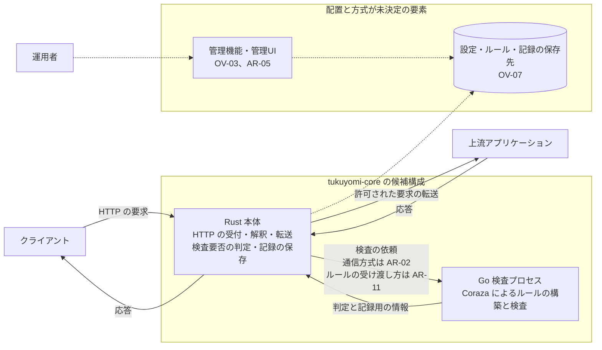
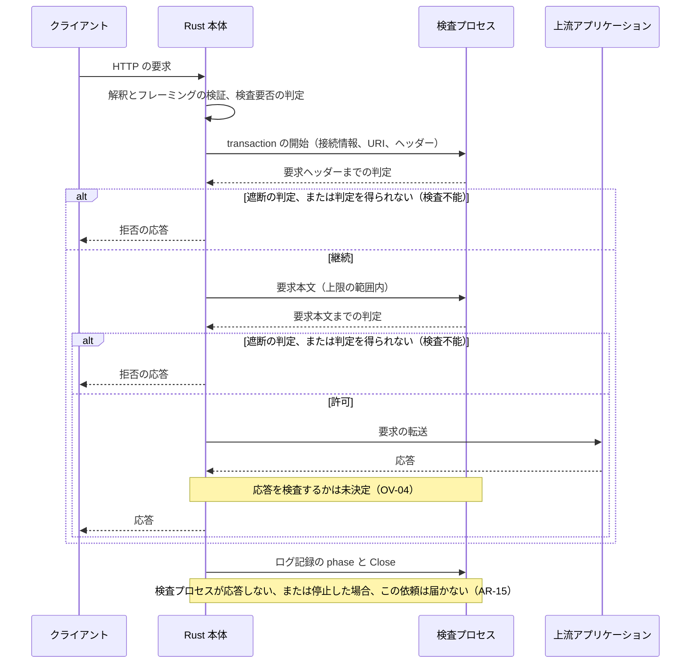

# アーキテクチャ概要

> **状態: 初期草案**
>
> この文書は全体構成の候補を示す。実装済みの範囲は [システム概要](system-overview.md) の「現在の状態」を参照。
> 図の要素は論理的な責務を表す。OS 上の配置、通信方式、ライブラリ、データベース、ポート、版を決めるものではない。

## この文書の範囲

検査エンジンとの接続方式の候補、責務の分担、障害の影響範囲、要求処理の流れの例、方式を問わず決める必要がある設計上の義務、状態 × 操作の表、採用の判断に必要な検証の候補を示す。

前提と用語は [システム概要](system-overview.md)、原則と検査モードの扱いは [設計方針・制約](design-principles.md) を参照する。

## 構成の候補

### 第一候補: Rust 本体と Go 検査プロセス

Rust 本体が HTTP の受付・解釈・転送、設定、記録の保存を担い、Coraza による検査を専用の小さな Go のプロセスに任せる案。

- 検査プロセスは Coraza の Go API を直接使い、libcoraza を挟まない案。
- 検査プロセスには、管理 API、設定・ルールの保存先への接続、上流への転送、クライアントとの直接の通信を持たせない案。
- この案を第一候補にする理由は、検査プロセスの異常終了に Rust 本体が巻き込まれることを避けられる可能性と、検査側の権限と資源を別に制限できる可能性があるため。通信が途切れないことを保証するものではない（「障害の影響範囲」を参照）。
- 代わりに、プロセス間通信、監督、準備完了の伝達、資源の回収の責務が増える（「共通の責務と、方式ごとに増える責務」を参照）。
- プロセスを分けるだけでは権限分離にならない（「権限と資源の境界」を参照）。全体としての採用は検証の後に判断する（AR-01。初回の検査核に限った採用は [システム概要](system-overview.md) の「現在の状態」）。

実線は候補構成での主な流れ、点線は配置や方式が未決定の関係を表す。

### 責務の分担（候補）

| 担当 | 担う責務（案） | 持たせない責務（案） |
|---|---|---|
| Rust 本体 | 接続の受付、TLS（終端を行うかは OV-06）、HTTP の解釈とフレーミングの検証、検査要否の判定、検査に渡す表現の作成、判定と記録用の情報の検証、判定の適用、上流への転送、設定の管理、記録の保存（検査記録をどちらが書くかは DP-10）、検査プロセスとの通信の管理 | Coraza のルールの評価 |
| Go 検査プロセス | ルールの構築と世代の保持、transaction の生成からログ記録の phase と Close まで、判定と記録用の情報の返却 | 管理 API、設定・ルールの保存先への接続（ルールの受け渡し方は AR-11）、上流への転送、クライアントとの直接の通信 |
| 監督（起動・停止・再起動） | 誰が担うかは未決定（AR-03） | — |
| 管理機能・管理UI | 範囲と配置は未決定（OV-03、AR-05） | — |

### 比較対象: Rust 本体から libcoraza を呼ぶ構成

libcoraza（Coraza の C ライブラリ）を Rust 本体から呼び、同じプロセスで検査する案。

- 独自のプロセス間通信を持たずに検査できる。
- C API の所有権・寿命・借用・コールバック・並行実行・初期化の失敗・エラーの変換を Rust 側へ安全につなぐ責務と、ネイティブライブラリのビルドと配布が要る。この FFI の境界は、採用する API に即して、異常系を含めて受入確認する（「採用判断に必要な検証」）。Go のランタイムも同じプロセスに入る。
- 接続ライブラリの版と、その中に含まれる Coraza の版の両方を固定し、修正版との対応を確かめる必要がある（DP-09）。
- 検査処理で回復できない障害が起きると、Rust 本体を含むプロセス全体が止まりうる。
- 単一のプロセスが必須になった場合（OV-06）や、別プロセスの通信・運用の負担が許容できない場合は、この案を優先して再評価する。

### 共通の責務と、方式ごとに増える責務

方式を比べるときは、HTTP の処理を Rust に置くこと自体から生じる責務と、方式ごとに増える責務を分けて数える。共通の責務があることは、両方式で実装の量や故障の種類が同じという意味ではない。

| 責務 | 両方式に共通 | 別プロセス案で増える | libcoraza 案で増える |
|---|---|---|---|
| HTTP の解釈と転送 | フレーミング、正規化、本文・トレーラー、検査する表現と転送する表現の関係 | 検査に渡す表現のメッセージ化と、Rust 本体と検査プロセスの間の契約 | 検査に渡す表現を C API の型へ変換する処理 |
| transaction | phase の順序、寿命、ログ記録と Close、ルールの世代 | 切断、メッセージの欠落・重複・取り違え、両側の状態の不一致、再起動の前後での判定の混入 | C API をまたぐ所有権・寿命・借用、コールバック、エラーの変換 |
| 本文と資源 | メモリ・ディスク・同時実行の上限、部分検査の意味 | 本文のコピー、通信の流量制御、待ち行列、取り残された要求の回収 | OS の資源制限がプロセス単位になるため、検査側だけを制限しにくい |
| 起動と更新 | 検査器の準備完了、ルールの構築・切り替え・旧世代の寿命 | 検査プロセスの準備完了の伝達、通信相手の確認、停止と再起動の監督 | ネイティブライブラリの読み込みと初期化の失敗 |
| ルールと権限 | DNS への問い合わせ、外部コマンド、ファイル・監査記録への書き込みなどに要る権限 | 検査プロセスに与える OS の権限と、その配布・運用 | 検査に要る権限を Rust 本体も持つ |
| ビルドと配布 | Rust と Go の両方のツールチェーン | 2つの実行ファイル、その起動の順序、版と通信の契約の組み合わせの整合（AR-13） | ネイティブライブラリのビルド、リンク、配布 |

どちらが速い、簡単、安全とは、比較の前に決めない。プロセス間通信が自動的に速い・簡単・安全になるわけではない。同じ検査範囲・同じ負荷で比べる（「採用判断に必要な検証」を参照）。

## 権限と資源の境界

プロセスを分けるだけでは、権限分離にならない。別プロセス案を採る場合は、少なくとも次を組で決める（AR-03、AR-04）。

- 検査プロセスを実行する利用者と、アクセスできるファイル。ルールが別のファイルを参照する場合は、その範囲も含める。
- 外部との通信の可否。ルールの機能によっては DNS への問い合わせ、外部コマンドの実行、ファイルへの書き込みが必要になるため、使える機能と組にして決める（DP-07）。
- メモリ、CPU、ディスク、同時実行の上限と、その掛け方。
- 起動、停止、再起動を誰が行い、どの条件で再起動するか。
- 本文を一時的にディスクへ退避する場合の置き場所、その権限・容量・回収（AR-09、AR-15）。

OS 上の具体的な分離の方法とデプロイ構成は、対応する環境（OV-06）とともに決める。

## 障害の影響範囲

別プロセス案で、検査プロセスが異常終了した、または強制終了した場合（計画停止・排出は AR-17 で別に扱う）:

- そのプロセスが処理中のすべての transaction を失う。要求ごとにキャンセルする仕組みではない。
- Rust 本体が動き続けても、通信が途切れないとは限らない。そのプロセスでは、再起動され（担当は AR-03）準備完了になるまで検査できない。代わりの検査プロセスがなければ、検査を必要とする通信（DP-02）は検査不能になり、拒否する案（DP-03）。
- 強制終了では transaction のログ記録の phase と Close が実行されない。検査記録の完全な復旧と一時ファイルの削除は保証できない。Rust 本体に残る情報で、その要求が未完了であることや記録に失敗したことを区別して記録する案（DP-10）。回収できない検査記録を、正常に完了したものとして扱わない。資源の回収の方法は AR-15。
- 資源の上限を明示しないと、検査プロセスの CPU・メモリ・ディスクの消費が、ほかの検査プロセスや Rust 本体を含むホストの資源に影響しうる。
- すでに上流へ送ったデータや、クライアントへ送り始めた応答は取り戻せない。検査の完了前に送ってよい範囲は AR-08。

libcoraza 案では、同じ種類の障害が Rust 本体を含むプロセス全体に及びうる。

どちらの案でも、障害の影響を小さくすることは、修正版の依存を使うことの代わりにならない（DP-09）。

## 要求処理の流れ（例）

検査を必要とする通信で、要求本文をすべて受け取ってから要求本文の判定を待つ場合の例。転送の開始と検査の完了の関係は未決定（AR-08）。明示的 bypass の経路を残す場合（DP-01）、その経路では検査プロセスを呼ばない案。

## 設計上の義務

次の項目は、方式を問わず決める必要がある。具体的な値や形式は未決定で、この文書では定めない。「案」と書いたものは採用前の案。

### HTTP の解釈とフレーミング（AR-06）

- 曖昧なフレーミング（Content-Length と Transfer-Encoding の併用、矛盾する重複ヘッダー、行の折り返しなど）を、拒否するか、規格が許す範囲で正規化するかを決める。拒否を基本とする案。
- 要求の密輸（request smuggling）を防ぐため、受け付けた要求を転送時に組み立て直すかを決める。
- 早い段階で拒否するとき、読み残した本文が同じ接続の次の要求として解釈されないようにする。`Expect: 100-continue` と接続の再利用の扱いを含める。
- HTTP/2 と HTTP/3 では、Cookie の分割、`:authority` と Host の関係などで、検査エンジンに渡す表現が HTTP/1.1 と変わり、ルールの結果が変わりうる（OV-05）。
- Upgrade（WebSocket など）の後の通信、双方向のストリーム、逐次送信する応答は、全体を受け取ってから評価する方式と両立しないことがある。扱いを決める（OV-05）。
- トレーラーは本文の後に届く。検査エンジンへ渡せるか、検査せずに転送してよいかを決める（AR-07）。
- 圧縮された本文は、伸長しないままでは平文の本文を検査できる保証がない。伸長する、拒否する、検査の範囲外と明記する、のどれにするか、どの符号化を対象にするかを決める。伸長する場合は、伸長後の大きさだけでなく、伸長に使う CPU・メモリ・ディスク・時間の上限と、上限を超えたときや伸長に失敗したときの扱い（AR-09、AR-14）、検査した伸長後の表現と転送する元の表現の対応（AR-07）を決める。
- これらは libcoraza 案でも Rust 本体に必要になる。

### 検査する表現と転送する表現（AR-07）

- 検査の後でパス、クエリ、Host、ヘッダーを書き換える場合、書き換えの前と後のどちらを、どのルールで検査するかを明文化する。
- 本文を伸長して検査する場合や、解析して検査する場合は、検査した表現と転送する元の表現が同じ内容を表すことを、どう保つかを決める（AR-06、AR-09）。
- bypass やルートの判定、検査、転送の間で、デコードと正規化を何回、どの順で行うかを揃える。判定と転送で解釈が違うと、判定をすり抜ける余地になる。
- 検査の要否やルートを判定できない要求（URI や Host を解釈できない、正規化の結果が食い違うなど）を、bypass として扱わない。扱いは DP-03。
- 意図したルーティングの書き換えもあるため、「すべての表現を同一にする」だけでは仕様にならない。

### 本文の解析・上限と部分検査（AR-09）

- 本文を検査エンジンへ渡しただけでは、本文の中の引数などが解析・検査されたとは言えない。採用する範囲の Content-Type ごとの本文の解析器（処理方法）の選択、要求と応答（応答を検査する場合、OV-04）のそれぞれで何を検査対象にするか、未知・未対応・不正な Content-Type の本文の扱いを、仕様と受入条件にする。採用する形式と値は未決定。
- 検査する本文全体の上限と、メモリに置く上限（超えた分をディスクへ退避する境界）を分けて決める。退避先を指定できるかは、採用する版で確かめる。
- 上限を超えた残りを未検査のまま流す部分検査は、検査を必要とする通信の fail-closed と両立しない。部分検査を許す範囲を決める。
- 引数の数などの上限によって、検査エンジンが入力の一部を検査せずに捨てることがある。上限に達したことを検知して拒否する設定とルールを、遮断するモードの受入条件にする。
- 本文の解析エラー、URI の解析エラー、multipart の厳格な検証の失敗をどう扱うかを、エンジン・設定・ルールの組で確かめる。
- 検査エンジンの推奨設定は参考にするが、そのまま製品の仕様にしない。推奨設定の初期値には、遮断しない動作や部分検査が含まれうる。
- 同時実行と待ち行列の上限、満杯のときの応答（AR-16）を決める。
- 検査器の上限（検査エンジンへ渡す本文や引数など）と、Rust 本体の受付・転送の上限（接続、ヘッダー、本文、同時実行、待ち行列、期限）を分けて決める。On、DetectionOnly、Off、明示的 bypass のどれを採っても、Rust 本体の受付・転送には資源と時間の境界を持たせる案。値と超過時の扱いは未決定。
- 検査プロセスへ割り当て済みの transaction と、割り当て前の待ち行列にいる要求を区別する。待機中の資源（保持している本文、接続）と同時実行の枠の持ち主、割り当てのときの引き渡しを決める。切断や期限超過で取り消した要求を、あとから割り当てない（「割り当て前の待機中の要求」の表）。

### transaction の phase・寿命・記録・Close（AR-10）

- 採用した検査範囲と経路ごとに、呼ぶ phase とその順序を、Rust 本体と検査エンジン（別プロセス案では検査プロセス）の間の呼び出しの契約として定める。契約に反する順序の違反、欠落、重複は、検査エンジンの警告だけに任せず、検査不能として扱う案。
- 早い段階の遮断の後に残りの phase を呼ばないこと、応答を検査しない場合（OV-04）に応答の phase を呼ばないこと、ルールの動作による意図した評価の打ち切り（その機能を採るかは DP-07）は、契約の中で区別し、不正な欠落と混同しない。
- transaction をいつ始めるか（受付の時点か、検査プロセスへ割り当てる時点か）を決める。待機中の要求の扱いは AR-09。
- 接続情報（クライアントのアドレス、サーバー名など）を検査エンジンに渡す。何を渡すかと、その値の出どころ（DP-08）を決める。
- 遮断の判定は、ステータスだけでなく、動作の種類（拒否、リダイレクト、切断など）と付随する情報を落とさずに Rust 本体へ返す。
- 遮断、許可、検査不能、クライアントの切断、期限超過、上流の障害のすべての経路で、ログ記録の phase と Close を誰がいつ行うかを決める。Close しないと、本文の一時ファイルや transaction の資源が残る。
- 検査記録（監査ログ）を検査プロセスが直接書くか、記録用の情報を Rust 本体へ返して Rust 本体が書くかは未決定（DP-10、AR-04）。
- 応答を検査する場合（OV-04）は、応答の判定まで transaction を保持する。

### ルールの世代の整合（AR-11）

- 検査エンジンに、使用中のルールを差し替える機能があるとは前提にしない。新しい検査器を構築してから参照を切り替える案。この案ではルールの切り替えに検査プロセスの再起動は要らないが、再起動で切り替える案と比べて決める（AR-17）。
- 1つの transaction は、開始時の世代で最後まで検査する。新しい世代へ切り替える時点、旧い世代を解放する条件、更新の直列化を決める。
- 切り替える前に新しい世代の構築に失敗し、現行の検査器が健全な場合は、現行の世代を使い続ける案。失敗の記録と、失敗した構築の資源の回収を確かめる。無効なルールを繰り返し検証したときの資源の上限も含める。
- 更新の途中で検査プロセスが異常終了した場合は、そのプロセスの transaction をすべて失う（「障害の影響範囲」）。切り替えは済んだが結果の通知を失った場合や、期限を過ぎた場合は、更新の失敗とも旧い世代の継続とも断定できない。実際に適用された世代を確かめる方法、再試行、再起動の後の世代の整合を決める（AR-13）。
- 待ち行列にいる要求をどの世代で検査するか（受付の時点で固定するか、割り当ての時点で固定するか）を決める。
- 複数のルールセット（既定とルートごとなど、残す場合）があるときは、それぞれの世代の整合と、選んだルールセットが使えないときの扱い（DP-04）を決める。
- ルールを検査プロセスへどう渡すか（Rust 本体から渡すか、検査プロセスが読み込むか）を、検査プロセスの権限（AR-04）とともに決める。検査プロセスが読み込む場合は、保存先への接続を持たせない案との整合と、読めるファイルの範囲を決める。
- 別プロセス案では、どの世代で判定したかを Rust 本体が確かめられるようにする案。

### 起動と準備完了（AR-12）

- 別プロセスにすると、Rust 本体が受付を始めていても、検査プロセスのルールがまだ構築されていない時間が生まれうる。受付の開始と準備完了の関係を決める。
- 準備完了の伝え方と、再起動の後に準備完了を確かめる方法を決める。準備完了の通知にも起動ごとの識別を含め、前の起動の通知と取り違えない（AR-13）。
- 外部（ヘルスチェックや負荷分散など）から見た準備完了を、検査プロセスの状態とどう結び付けるかを決める。
- 初期のルールの構築に失敗したとき、起動を中止するか、検査を必要とする通信を拒否したまま待つかを決める。
- ルールの更新の失敗は AR-11 で扱う。

### プロセス間のメッセージ（AR-02、AR-13）

- 攻撃者が送ったバイト列がメッセージに入る前提で設計する。メッセージの境界と長さを検証できる形式にし、種類ごとに上限を決め、上限を超えたら検査不能とする案。
- 内部の transaction の識別子は Rust 本体が採番する案。クライアントが送った要求 ID（`X-Request-ID` など）をそのまま使わない。外部の相関情報と内部の識別子を分ける。
- 再起動の前後で判定が混ざらないよう、Rust 本体と検査プロセスのそれぞれの起動ごとの識別をメッセージに含める案。前の起動の識別を持つ判定や、終了済み・取り消し済みの要求への遅れた判定、重複した判定は捨て、それだけで現行の transaction を検査不能にはしない案。
- 相関できる個別のメッセージの異常（型・長さ・範囲の不正、その transaction の順序違反）は、その transaction だけを検査不能とする案。共有する接続が切れた場合や、メッセージの境界が壊れて以降を信頼できない場合は、その接続で処理中のすべての transaction が影響を受ける。
- 準備完了と更新の結果の通知にも、起動ごとの識別と更新の相関を含める案（AR-11、AR-12）。
- 検査プロセスから返る判定と記録用の情報も、Rust 本体で型・長さ・範囲を検証する（DP-10）。
- 通信相手の確かめ方は、双方向で決める。検査プロセスも、意図しない接続元からの依頼を受け付けない。方法は通信方式とともに決める。
- 2つの実行ファイルの版の組み合わせと、通信の契約・能力が合わない場合に、それを検知して受け付けないか、適合する組として配布するかなど、整合の取り方を決める（OV-06、DP-09）。段階的な更新を採るか、必須にするかは決めていない。
- 通信方式とメッセージ形式は未決定（AR-02）。同一ホスト内の Unix domain socket は候補の1つで、必須ではない。

### 期限と実際のキャンセル（AR-14）

- 期限の種類を分けて決める。少なくとも、クライアントからの受信（遅い送信を含む）、クライアントへの送信、使われていない接続の保持、待ち行列での待機、本文の伸長、上流への接続と応答、検査の判定待ち、排出の期限がある。値は未決定。
- Rust 本体が期限で待つのをやめても、検査プロセスの評価が止まるとは限らない。ルールの評価が途中で中断できる保証はない。
- 要求ごとの期限と、検査プロセスに実際に残る処理の量（同時実行の上限）を分けて決める。同時実行の枠をいつ返すかを決める。
- 期限を過ぎた、検査を必要とする通信は、検査不能として拒否する案。期限の後に届いた判定は捨てる案（AR-13）。
- 強制再起動は、要求ごとのキャンセルの代わりにならない。同じプロセスのほかの transaction も失われる。応答しない検査プロセスを強制再起動する条件は AR-03 で決める。

### 資源の回収（AR-15）

- 通常の経路と、計画停止・排出の期限内に終えた transaction では、ログ記録の phase と Close によって資源を回収する。排出の期限を過ぎて止めたものは、異常終了と同じ扱いになりうる（AR-17）。
- 検査プロセスの強制終了では Close が実行されない。検査プロセスごとに専用の一時領域を持たせ、その起動の識別と持ち主を結び付け、持ち主のプロセスが終了したことを確かめてから回収する案。生きているプロセスや別の transaction の資源を消さない。旧いプロセスがまだ生きている場合や、終了を確かめられない場合の扱いは未決定。
- 回収できなかった検査記録の扱いは「障害の影響範囲」と DP-10。
- Rust 本体が異常終了した場合は、通信相手を失ったことを検知した検査プロセスが、未完了の transaction を Close する案。
- Rust 本体の側でも、判定を待っている状態や同時実行の枠など、取り残された状態を回収する。

### 停止と設定の再読込（AR-17）

- 検査プロセスを計画して止める場合（検査プロセスの更新など。ルールの切り替えに再起動が要るかは AR-11）は、新しい transaction を割り当てず、進行中のものを期限まで待ってログ記録の phase と Close を行う案。異常終了とは別に扱う。
- Rust 本体の停止と設定の再読込で、進行中の要求、待ち行列にいる要求、検査プロセスへの通知、記録の扱いを決める。検査の要否を判定した設定を、いつ固定して保持するか（受付の時点か、割り当ての時点か）を決める。設定の再読込に失敗した場合は、現行の設定を使い続ける案。

### 上流の障害（AR-18）

- 上流への接続の失敗、期限超過、切断、不正な応答でも、transaction のログ記録の phase と Close を行う。
- 上流の障害は、遮断や検査不能とは別の理由として記録する案。
- クライアントへ返す応答は AR-16。同じ要求を上流へ送り直すかは、検査の範囲とあわせて未決定。

## 状態 × 操作

前提: 別プロセス案で、検査器の動作が On の、検査を必要とする通信。DetectionOnly、Off、明示的 bypass、ルール選択の失敗の扱いは [設計方針・制約](design-principles.md) の表を参照する。libcoraza 案では、検査プロセスの行は Rust 本体を含むプロセス全体の状態に置き換わる。

表の読み方:

- 表のすべての記述は採用前の候補で、実装済みの挙動ではない。初回の検査核の実装済みの範囲は [システム概要](system-overview.md) の「現在の状態」に分けて書く。
- 「案」は特に代わりの案が考えられるもの、ID は未決定の詳細を指す。案も ID もない記述は、方式を問わず満たす必要がある性質（要件の候補）とする。
- 「新規の要求」はその状態の間に届く要求、「進行中の transaction」は検査プロセスへ割り当て済みのものを指す。割り当て前に待ち行列にいる要求は「割り当て前の待機中の要求」の表に分ける。
- 「明示的 bypass の要求」の列は、bypass を残す場合（DP-01）に限る。
- 「応答の返却」の列で、応答を送り始めた後は、ステータスを変えられず、打ち切るか途中で切るかしか残らない（AR-08）。

### 検査プロセスとプロセス間通信

| 状態 | 検査を必要とする新規の要求 | 進行中の transaction | 明示的 bypass の要求（残す場合） | 応答の返却 | ルールの更新 |
|---|---|---|---|---|---|
| 起動中（準備完了の前） | 割り当てない。ほかに準備完了の検査プロセスがなければ、検査不能として拒否する案。受付の開始との関係は AR-12 | なし | 検査プロセスの準備を待たずに通すかは DP-01、AR-12 | — | 初期のルールの構築に失敗したときの扱いは AR-12 |
| 準備完了 | 開始時の世代で検査する。遮断の判定と転送の開始の関係は AR-08 | 契約した phase を順に処理し、ログ記録の phase と Close まで責任を持つ（AR-10） | 検査プロセスを呼ばない案。検査しなかった理由を記録する（DP-01、DP-05） | 応答を検査するかは OV-04 | 検証して新しい世代を構築し、新規の transaction から切り替える案（AR-11） |
| 計画停止・排出 | 停止するプロセスに割り当てない。代わりがなければ検査不能として拒否する案 | 期限まで完了を待ち、ログ記録の phase と Close を行う案。期限を過ぎた分は AR-17 | 影響を受けない案 | 送り始めた後は AR-08 | 停止中に更新を受け付けるかは AR-17 |
| 異常終了・強制終了 | 再起動され（担当は AR-03）準備完了になるまで、そのプロセスでは検査できない。代わりがなければ検査不能として拒否する案。返す応答は AR-16 | そのプロセスの transaction をすべて失う。未転送の要求は拒否する案。転送済みのデータは取り戻せない。ログ記録の phase と Close は実行されず、未完了として記録する案（AR-15、DP-10） | 検査プロセスを使わないため直接の影響はない案。ホストの資源への影響は別（AR-04） | 応答を検査する場合、送り始める前なら止める案。送り始めた後は AR-08 | 実行中の更新は結果を確かめられない。再起動後に構築する世代は AR-11 |
| 応答しない（停止はしていない） | 判定待ちの期限を過ぎたら検査不能として拒否する案（AR-14）。新しい transaction を割り当て続けるかは AR-03 | 待つのをやめても、検査プロセスの処理は残りうる。強制再起動の条件は AR-03、AR-14 | 影響を受けない案 | 送り始めた後は AR-08 | 更新の期限と、結果が不明なときの扱いは AR-11 |
| 再起動中（準備完了の確認前） | 準備完了を確かめるまで割り当てない。代わりがなければ拒否する案（AR-12） | 前の起動の識別を持つ判定は捨てる案（AR-13） | 影響を受けない案 | — | 再起動時に構築する世代と、更新の再試行は AR-11 |
| 相関できる個別のメッセージの異常（型・長さ・範囲の不正、その transaction の順序違反） | 影響しない | その transaction だけを検査不能とする案（AR-13） | — | 送り始めた後は AR-08 | 更新のメッセージの異常は、結果が不明な更新として扱う案（AR-11） |
| 共有する接続の切断・メッセージの境界の破損・通信相手の確認の失敗 | 接続を作り直して準備完了を確かめるまで割り当てない。代わりがなければ検査不能として拒否する案 | その接続で処理中のすべての transaction を検査不能とする案（AR-02、AR-13） | — | 送り始めた後は AR-08 | 実行中の更新は結果が不明になる。適用された世代の確認は AR-11、AR-13 |
| 古い判定（前の起動の識別、終了済み・取り消し済みの要求への遅れた判定、重複） | 影響しない | 捨てる。それだけで現行の transaction を検査不能にはしない案（AR-13） | — | — | 古い更新の結果の通知も捨てる案（AR-13） |

### 要求・資源・上流・記録

| 状態 | 検査を必要とする新規の要求 | 進行中の transaction | 明示的 bypass の要求（残す場合） | 応答の返却 | ルールの更新 |
|---|---|---|---|---|---|
| 期限超過（期限の種類は AR-14） | 検査不能として拒否する案 | 待つのをやめても、検査プロセスの評価は続きうる。期限の後に届いた判定は捨てる案（AR-13）。同時実行の枠を返す時点は AR-14 | 転送の期限は AR-14 | 送り始めた後は AR-08 | 更新の期限は AR-11 |
| クライアントの切断（転送の開始前） | 転送しない。ログ記録の phase と Close を行う（AR-10） | 同じ | 転送しない | — | — |
| クライアントの切断（転送の開始後） | — | 上流への転送を打ち切るかは AR-08。ログ記録の phase と Close を行う（AR-10） | 上流への転送を打ち切るかは AR-08 | 返却を打ち切り、資源を解放する（AR-10） | — |
| 本文・引数の上限超過 | 値と拒否の条件は AR-09。未検査の残りを転送する部分検査は、検査を必要とする通信の fail-closed と両立しない | 上限に達した transaction を検査不能とする案。検査エンジンが捨てた入力を検知して拒否する（AR-09） | Rust 本体の受付・転送の上限は持つ案。値と超過時の扱いは AR-09 | 応答本文の上限は OV-04、AR-09 | — |
| 同時実行・待ち行列の上限超過 | transaction を作らずに拒否する案。上限の値は AR-09、返す応答は AR-16 | 影響を受けない案 | Rust 本体の同時実行の上限は持つ案。値と超過時の扱いは AR-09 | — | ルールの構築に使う資源の上限は AR-11 |
| ディスクの不足・退避先の異常 | 退避が要る要求は検査不能として拒否する案（AR-09） | 退避中の transaction を検査不能とする案。Rust 本体を含むほかの処理への影響は AR-04 | 影響の範囲は AR-04 | 送り始めた後は AR-08 | — |
| 上流の障害（接続失敗、期限超過、切断、不正な応答） | 検査の後に起きる。返す応答は AR-16 | ログ記録の phase と Close を行う。遮断や検査不能とは別の理由として記録する案（AR-18） | 同じ扱い（AR-18） | 送り始めた後は AR-08 | — |
| 記録先の障害（満杯、使えない） | 記録できないときに転送を続けるかは DP-10 | 同じ | 同じ | — | 更新の記録も DP-10 |

### 割り当て前の待機中の要求

検査を必要とする通信で、受け付けた後、検査プロセスへ割り当てる前に待ち行列にいる要求の扱い。待機中の資源と同時実行の枠の持ち主、割り当てのときの引き渡しは AR-09。

| 状態 | 待機中の要求の扱い（候補） |
|---|---|
| クライアントの切断 | 待ち行列から外し、資源を解放する。あとから割り当てない |
| 待機の期限超過（AR-14） | 待ち行列から外し、検査不能として拒否する案（AR-16）。あとから割り当てない |
| 割り当て先の候補の検査プロセスの計画停止・排出 | 停止するプロセスへ割り当てない。ほかの検査プロセスへ回すか、拒否するかは AR-17 |
| 検査プロセスの異常終了・応答しない・共有する接続の切断 | 待機中の要求はまだ失われていない。ほかの検査プロセスへ回すか、待つか、拒否するかは AR-03、AR-14 |
| ルールの更新 | どの世代で検査するか（受付の時点で固定するか、割り当ての時点で固定するか）は AR-11 |
| Rust 本体の設定の再読込 | 検査の要否を判定した設定をいつ固定して保持するかは AR-17 |
| Rust 本体の計画停止 | 待機中の要求を割り当てるか、拒否するかは AR-17 |

### ルールと Rust 本体

| 状態 | 検査を必要とする新規の要求 | 進行中の transaction | 明示的 bypass の要求（残す場合） | 応答の返却 | ルールの更新 |
|---|---|---|---|---|---|
| ルールの更新中 | 旧か新のどちらか1つの世代で検査する。世代を混ぜない（AR-11） | 開始時の世代で最後まで検査する | — | 同じ transaction は同じ世代を使う | 同時に来た更新の直列化は AR-11 |
| ルールの更新の失敗（切り替え前の構築の失敗で、現行の検査器が健全な場合） | 現行の世代を使い続ける案 | 影響を受けない案 | — | — | 失敗を記録し、失敗した構築の資源を回収する。運用者へ知らせる手段は OV-03、AR-05 |
| ルールの更新の結果が不明（切り替えの結果の通知の喪失、期限超過） | 判定ごとに、どの世代で検査したかを確かめる案（AR-11、AR-13） | 開始時の世代で最後まで検査する | — | — | 失敗とも旧い世代の継続とも断定しない。適用された世代の確認と再試行は AR-11、AR-13 |
| Rust 本体の起動中 | 受付を始める条件と、外部から見た準備完了は AR-12 | なし | 検査プロセスの準備を待たずに通すかは DP-01、AR-12 | — | 起動時のルールの構築は AR-11、AR-12 |
| Rust 本体の計画停止 | 受付を止める案 | 完了を待つ期限、検査プロセスへの通知、ログ記録の phase と Close は AR-17 | 進行中の扱いは AR-17 | 送り始めた後は AR-08 | 停止中は更新を受け付けない案 |
| Rust 本体の異常終了・再起動 | 再起動して準備完了になるまで受け付けられない（AR-12） | 転送中の要求は失われる。検査プロセスに残った transaction は、通信相手の喪失を検知して Close する案（AR-15）。前の Rust 本体からの依頼と取り違えない（AR-13） | 転送中の要求は失われる | 返却中の応答は途切れる | 実行中の更新は結果が不明になる。適用された世代は再起動の後に確かめる（AR-11、AR-13） |
| Rust 本体の設定の再読込 | 再読込の前後どちらの設定で検査の要否を判定するかを、要求ごとに1つに定める（AR-17） | 開始時の設定で最後まで扱う案 | bypass の設定の変更も同じ扱い（AR-17、DP-01） | 開始時の設定で扱う案 | 設定とルールの世代の整合は AR-11、AR-17 |
| Rust 本体の設定の再読込の失敗 | 現行の設定を使い続ける案（AR-17） | 影響を受けない案 | 同じ | — | 失敗を記録する。運用者へ知らせる手段は OV-03、AR-05 |

## 採用判断に必要な検証（候補）

比較の条件と許容値は、検証の前に決める。検証に使う依存とルールの版は DP-09 に従って確かめる。

1. 正常な要求と本文を上流へ正しく渡し、URI・ヘッダー・クエリ・本文の代表的な検知が、Coraza の Go API を直接使った場合と一致する。要求ヘッダーの段階での遮断も確かめる。この一致は、採用した検査範囲を満たす証明にはならない。Content-Type と解析器ごとの検査対象（AR-09）を仕様とし、仕様に対しても確かめる。
2. 応答を検査する場合（OV-04）、応答での遮断と transaction の寿命を確かめる。
3. 検査プロセスの停止、通信断、期限超過、クライアントの切断で、検査を必要とする通信が未検査のまま通らず、Rust 本体の側に待ち状態や同時実行の枠が取り残されない。
4. phase の呼び出しの契約に反する順序違反・欠落・重複を検査不能として扱い、早い段階の遮断など契約で認めた非実行を検査不能と誤らない。メッセージの相関できる個別の異常はその transaction だけを、共有する接続の切断や境界の破損はその接続の transaction をすべて検査不能とし、古い判定は捨てて現行の transaction に影響させない。
5. 複数の transaction の途中で検査プロセスを止める。計画停止・排出では、期限内に終えた transaction のログ記録の phase と Close が完了する。異常終了・強制終了では、判定の取り違えがなく、Rust 本体に残る情報で未完了・記録の失敗を区別して記録でき、資源と一時ファイルを、生きているプロセスのものを消さずに回収できる。完全な記録の復旧は求めないが、回収できない記録を正常な完了として扱わない。
6. 検査プロセスを故意に異常終了させる仕組みを使い、Rust 本体とほかの要求への影響の範囲を確かめる。
7. 本文の大きさ、伸長、同時実行、待ち行列、遅い送信の境界で、メモリ、CPU、待ち行列、ディスクの使用が決めた上限に収まる。取り消した待機中の要求が、あとから割り当てられない。
8. 引数の数の上限に達した要求、解析できない本文、厳格な検証に失敗した multipart、未知・未対応の Content-Type の本文が、遮断するモードで決めたとおりに扱われる。
9. ルールの更新中、切り替え前の構築の失敗、結果が不明な更新（通知の喪失、期限超過）で世代が混ざらず、適用された世代を確かめられ、失敗した構築の資源が回収される。
10. ルール選択の失敗時の fallback と、明示的 bypass・DetectionOnly・Off を分けた結果になる。
11. 検査、bypass の判定、転送の間で、表現の解釈が食い違わない。伸長・解析して検査した表現と、転送する表現の対応も含む。
12. 同じルール・本文・負荷で、遅延、処理量、メモリ、ビルド・配布・運用の負担を各案で比べる。Go API を直接使う側の Coraza の版と、libcoraza に含まれる Coraza の版を記録して比較の条件に含め、できれば揃える。揃わない場合は、接続方式だけの差とは結論しない（DP-09）。
13. 記録の出力が、機微なデータの漏えいや、記録を閲覧・解析する側への入力の注入の入口にならない（DP-10）。
14. libcoraza 案では、採用する API に即して、所有権・寿命・借用・コールバック・並行実行・初期化の失敗・エラーの変換を、異常系を含めて確かめる。同じプロセスでの障害の影響範囲だけで比較を終えない。

3、5、6 は、libcoraza 案では、同じ障害がプロセス全体に及ぶ範囲として確かめる。

## 未決事項

| ID | 事項 | 現在の扱い | 関連 |
|---|---|---|---|
| AR-01 | 検査エンジンとの接続方式 | 第一候補は Go 検査プロセス、比較対象は libcoraza。初回の検査核に限って、Go 検査プロセスの構成を採った（[システム概要](system-overview.md) の「現在の状態」）。全体としての採用は、libcoraza との比較を含む検証の後に判断する | OV-06、DP-09 |
| AR-02 | プロセス間通信の方式とメッセージ形式（別プロセス案の場合） | 未決定。同一ホスト内の Unix domain socket は候補の1つ | AR-13 |
| AR-03 | 検査プロセスの数、監督（起動・停止・再起動の担当）、再起動の条件 | 未決定 | OV-06、AR-14、AR-17 |
| AR-04 | 検査プロセスの権限と OS 上の資源の制限 | 未決定 | OV-06、DP-07 |
| AR-05 | 管理機能の配置（どのプロセスが管理の入口を持つか）と、採る場合の認証、操作ごとの権限の分け方、変更の履歴と適用範囲 | 未決定 | OV-03、OV-07、DP-10 |
| AR-06 | HTTP の解釈とフレーミングの不変条件、拒否または正規化する入力 | 未決定。拒否を基本とする案 | OV-05 |
| AR-07 | 検査する表現と転送する表現の対応 | 未決定 | OV-01、DP-05 |
| AR-08 | 転送の開始と検査の完了の関係（本文をどこまで受け取ってから送るか）、応答を送り始めた後の扱い | 未決定 | OV-04、OV-05 |
| AR-09 | 本文の解析と検査対象（Content-Type ごと）、本文・伸長・引数・同時実行・待ち行列・ディスク退避の上限と超えたときの扱い（検査器の上限と Rust 本体の上限を分ける）、待機中の要求の資源と枠 | 未決定 | AR-16、DP-03、OV-04 |
| AR-10 | transaction の開始の時点、経路ごとの phase の呼び出しの契約、寿命・ログ記録・Close の責任 | 未決定 | AR-15、DP-07、DP-08、DP-10、OV-04 |
| AR-11 | ルールの世代の切り替え、旧世代の寿命、更新の直列化、失敗時と結果が不明なときの扱い（確認と再試行）、ルールの受け渡し、待機中の要求の世代 | 未決定 | OV-07、AR-04、AR-13、DP-04 |
| AR-12 | 起動、準備完了、受付の開始の関係と、外部から見た準備完了 | 未決定 | AR-03 |
| AR-13 | メッセージの境界・長さ・上限、相関、双方の起動ごとの識別、個別の異常と接続全体の異常の区別、準備完了と更新の結果の通知の相関、通信相手の確認、2つの実行ファイルの版と通信の契約の整合 | 未決定 | AR-02、AR-11、AR-12、OV-06、DP-09 |
| AR-14 | 期限の種類（伸長と待ち行列での待機を含む）と値、期限を過ぎた後の扱い | 未決定 | AR-03、AR-09 |
| AR-15 | 異常終了の後の資源の回収（検査プロセス側と Rust 本体側、回収対象の持ち主と終了の確認） | 未決定 | AR-03、AR-10、DP-10 |
| AR-16 | 拒否、検査不能、上流の障害のときにクライアントへ返す応答 | 未決定 | DP-03、AR-18 |
| AR-17 | 計画停止・排出と、Rust 本体の停止・設定の再読込（失敗を含む）、待機中の要求の扱いと設定を固定する時点 | 未決定 | AR-03、AR-11、OV-06 |
| AR-18 | 上流の障害（接続失敗、期限超過、切断、不正な応答）の扱いと記録 | 未決定 | AR-16、DP-10 |

## 関連文書

- [システム概要](system-overview.md)
- [設計方針・制約](design-principles.md)
- [設計文書の入口](../../README.md)
