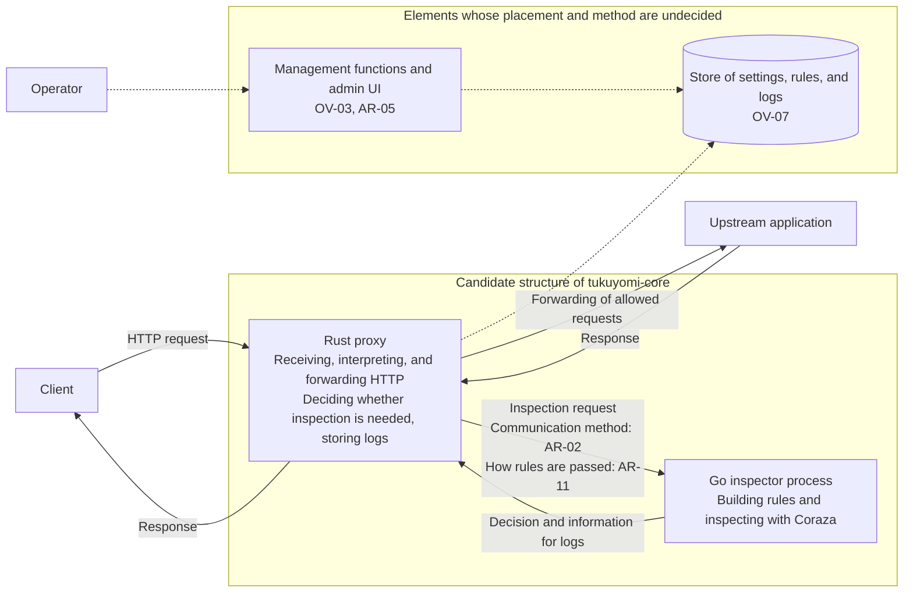
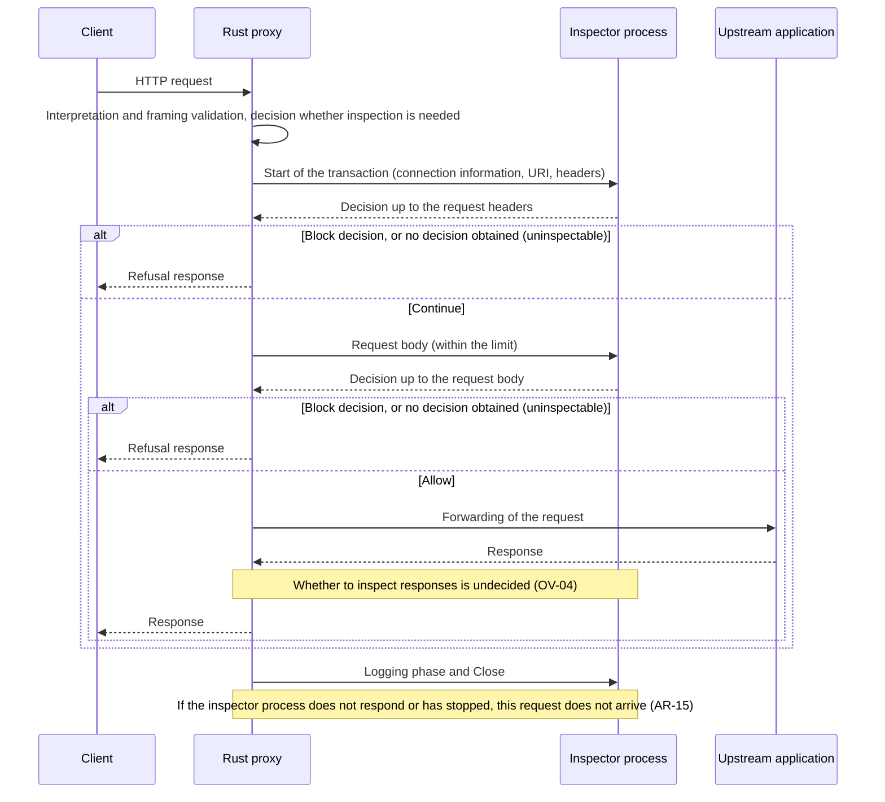

[English](architecture.md) | [日本語](architecture.ja.md)

# Architecture Overview

> **Status: initial draft**
>
> This document shows candidates for the overall structure. For the implemented scope, see "Current Status" in the [system overview](system-overview.md).
> The elements in the diagrams represent logical responsibilities. They do not decide the placement on the OS, the communication method, the libraries, the database, the ports, or the versions.

## Scope of This Document

This document shows the candidates for the connection method to the inspection engine, the division of responsibilities, the failure scope, an example of the request processing flow, the design obligations that must be decided whichever approach is chosen, the States × Operations tables, and the candidate checks needed to decide on adoption.

For the assumptions and terms, see the [system overview](system-overview.md). For the principles and the handling of inspection modes, see [design principles and constraints](design-principles.md).

## Candidate Structure

### First Candidate: a Rust Proxy and a Go Inspector

The proposal is that the Rust proxy handles receiving, interpreting, and forwarding HTTP, the configuration, and the storing of logs, and leaves inspection with Coraza to a dedicated small Go process.

- The proposal is that the inspector process uses the Coraza Go API directly, without libcoraza in between.
- The proposal is that the inspector process has no admin API, no connection to the store of settings and rules, no forwarding to upstreams, and no direct communication with clients.
- The reasons for making this proposal the first candidate are that the Rust proxy may be able to avoid being drawn into an abnormal exit of the inspector process, and that the privileges and resources of the inspection side may be restricted separately. It does not guarantee that communication is never interrupted (see "Failure Scope").
- In exchange, the responsibilities for inter-process communication, for managing start, stop, and restart by the supervisor, for conveying readiness, and for reclaiming resources increase (see "Shared Responsibilities and Those Each Approach Adds").
- Separating processes alone does not give privilege separation (see "Privilege and Resource Boundaries"). Whether to adopt this structure as a whole is decided after verification (AR-01; for the adoption limited to the initial implementation of the inspection kernel, see "Current Status" in the [system overview](system-overview.md)).

Solid lines show the main flows in the candidate structure, and dotted lines show relations whose placement or method is undecided.

### Division of Responsibilities (Candidate)

| Owner | Responsibilities (proposal) | Responsibilities not given (proposal) |
|---|---|---|
| Rust proxy | Accepting connections, TLS (whether to terminate TLS is OV-06), interpreting HTTP and validating framing, deciding whether inspection is needed, building the form passed to inspection, validating the decision and the information for logs, applying the decision, forwarding to the upstream, managing the configuration, storing logs (which side writes inspection logs is DP-10), and managing communication with the inspector process | Evaluating Coraza rules |
| Go inspector process | Building rules and holding generations; transactions, from creation to the logging phase (phase 5) and Close; and returning the decision and the information for logs | The admin API, a connection to the store of settings and rules (how rules are passed is AR-11), forwarding to the upstream, and direct communication with clients |
| Supervisor (start, stop, restart) | Which process is responsible is undecided (AR-03) | — |
| Management functions and admin UI | The scope and placement are undecided (OV-03, AR-05) | — |

### Compared: Calling libcoraza from the Rust Proxy

This is a proposal in which the Rust proxy calls libcoraza (the C library of Coraza) and inspects in the same process.

- Inspection is possible without inter-process communication of its own.
- It requires responsibilities to connect the ownership, lifetime, borrowing, callbacks, concurrent execution, initialization failures, and error conversion of the C API safely to the Rust side, and it requires building and distributing the native library. This FFI boundary is checked for acceptance, including failure cases, against the API to be adopted (see "Checks Needed for the Decision (Candidates)"). The Go runtime also enters the same process.
- Both the version of the connection library and the version of Coraza included in it must be pinned, and the correspondence with patched versions must be checked (DP-09).
- If an unrecoverable failure occurs in inspection, the whole process including the Rust proxy may stop.
- If a single process becomes mandatory (OV-06), or if the communication and operational burden of a separate process is not acceptable, this proposal is re-evaluated with priority.

### Shared Responsibilities and Those Each Approach Adds

When comparing the approaches, count separately the responsibilities that arise from placing HTTP processing in Rust itself and the responsibilities that each approach adds. That a responsibility is shared does not mean the amount of implementation or the kinds of failure are the same in both approaches.

| Responsibility | Shared by both approaches | Added by the separate-process proposal | Added by the libcoraza proposal |
|---|---|---|---|
| HTTP interpretation and forwarding | Framing, normalization, bodies and trailers, and the relation between the form passed to inspection and the form forwarded | Turning the form passed to inspection into messages, and the contract between the Rust proxy and the inspector process | Converting the form passed to inspection into the types of the C API |
| Transactions | The order of phases, lifetime, the logging phase and Close, and rule generations | Disconnection, lost, duplicated, or mixed-up messages, mismatch of state between the two sides, and decisions mixing across a restart | Ownership, lifetime, and borrowing across the C API, callbacks, and error conversion |
| Bodies and resources | Limits on memory, disk, and concurrency, and the meaning of partial inspection | Copying of bodies, flow control of communication, queues, and reclaiming stranded requests | OS resource limits become per-process, so it becomes harder to restrict only the inspection side |
| Start and update | Readiness of the WAF instance, building and switching rules, and the lifetime of old generations | Conveying the readiness of the inspector process, verifying the communication peer, and managing stop and restart by the supervisor | Failures in loading and initializing the native library |
| Rules and privileges | The privileges needed for DNS queries, external commands, and writing to files and audit logs | The OS privileges given to the inspector process, and their distribution and operation | The Rust proxy also holds the privileges needed for inspection |
| Build and distribution | Both the Rust and Go toolchains | Two executables, the order of starting them, and consistency of the combination of versions and communication contracts (AR-13) | Building, linking, and distributing the native library |

Which approach is faster, simpler, or safer is not decided before the comparison. Inter-process communication does not automatically become faster, simpler, or safer. Compare with the same inspection scope and the same load (see "Checks Needed for the Decision (Candidates)").

## Privilege and Resource Boundaries

Separating processes alone does not give privilege separation. If the separate-process proposal is adopted, decide at least the following as a set (AR-03, AR-04).

- The OS user that runs the inspector process, and the files it can access. If rules refer to other files, include that range.
- Whether external communication is allowed. Depending on the functions of the rules, DNS queries, running external commands, and writing to files may be needed, so decide this together with the functions that can be used (DP-07).
- The limits on memory, CPU, disk, and concurrency, and how they are applied
- Which process starts, stops, and restarts, and under what conditions it restarts
- If bodies are temporarily spilled to disk, the spill destination, and its permissions, capacity, and reclaiming (AR-09, AR-15)

The concrete method of isolation on the OS and the deployment structure are decided together with the supported environments (OV-06).

## Failure Scope

If an inspector process exits abnormally or is killed in the separate-process proposal, the following applies (planned stops and draining are handled separately in AR-17).

- All transactions that the process was handling are lost. It is not a mechanism that cancels each request.
- Even if the Rust proxy keeps running, communication is not necessarily uninterrupted. That process cannot inspect until it is restarted (the responsible party is AR-03) and ready. If there is no substitute inspector process, traffic that requires inspection (DP-02) becomes uninspectable, and the proposal is to refuse it (DP-03).
- When the process is killed, the logging phase and Close of the transactions are not run. A complete recovery of inspection logs and deletion of temporary files cannot be guaranteed. The proposal is to record distinctly, from the information that remains in the Rust proxy, that the request was incomplete and that recording the log failed (DP-10). Inspection logs that cannot be recovered are not treated as having completed normally. For how to reclaim resources, see AR-15.
- If the limits on resources are not made explicit, the CPU, memory, and disk consumption of an inspector process may affect other inspector processes and the resources of the host, including the Rust proxy.
- Data already sent to the upstream and a response already started to the client cannot be taken back. The range that may be sent before inspection completes is handled in AR-08.

In the libcoraza proposal, the same kind of failure may spread to the whole process, including the Rust proxy.

In either proposal, reducing the effect of failures does not replace using patched versions of dependencies (DP-09).

## Request Flow (Example)

This is an example in which, for traffic that requires inspection, the whole request body is received and then the decision on the request body is awaited. The relation between the start of forwarding and the completion of inspection is undecided (AR-08). If routes with an explicit bypass are kept (DP-01), the proposal is not to call the inspector process on those routes.

## Design Obligations

The following items must be decided whichever approach is chosen. The concrete values and formats are undecided and are not defined in this document. What is written as a "proposal" is a proposal before adoption.

### HTTP Parsing and Framing (AR-06)

- Decide whether to refuse ambiguous framing (a combination of Content-Length and Transfer-Encoding, contradictory duplicate headers, line folding, and so on) or to normalize it within what the standards allow. The proposal is to refuse as the basic approach.
- Decide whether to rebuild a received request when forwarding it, in order to prevent request smuggling.
- When refusing early, make sure that a body left unread is not interpreted as the next request on the same connection. Include the handling of `Expect: 100-continue` and connection reuse.
- In HTTP/2 and HTTP/3, the form passed to the inspection engine differs from HTTP/1.1 because of cookie splitting, the relation between `:authority` and Host, and so on, and the results of rules may change (OV-05).
- Communication after an Upgrade (WebSocket and so on), bidirectional streams, and responses sent incrementally may not be compatible with an approach that evaluates after receiving everything. Decide how to handle them (OV-05).
- Trailers arrive after the body. Decide whether they can be passed to the inspection engine, or may be forwarded without inspection (AR-07).
- A compressed body gives no guarantee that the plaintext body can be inspected without decompression. Decide which of decompressing, refusing, or stating explicitly that it is out of the inspection scope to take, and which encodings are covered. If decompressing, decide not only the size after decompression but also the limits on the CPU, memory, disk, and time used for decompression, the handling when a limit is exceeded or decompression fails (AR-09, AR-14), and the correspondence between the decompressed form that was inspected and the original form that is forwarded (AR-07).
- These are also needed in the Rust proxy in the libcoraza proposal.

### Inspected and Forwarded Forms (AR-07)

- If the path, query, Host, or headers are rewritten after inspection, state explicitly which of the form before and the form after the rewrite is inspected, and by which rule.
- When a body is decompressed and inspected, or parsed and inspected, decide how to keep the inspected form and the original forwarded form representing the same content (AR-06, AR-09).
- Align how many times, and in what order, decoding and normalization are done among the decision on bypass and routes, inspection, and forwarding. If the decision and forwarding interpret differently, there is room to slip past the decision.
- A request for which whether to inspect, or the route, cannot be decided (the URI or Host cannot be interpreted, normalization results disagree, and so on) is not treated as a bypass. The handling is decided in DP-03.
- Because some rewriting of routing is intended, "make all forms identical" alone is not a specification.

### Body Parsing, Limits and Partial Inspection (AR-09)

- Merely passing a body to the inspection engine does not mean the arguments and so on in the body were parsed and inspected. Make the following the specification and the acceptance conditions: the selection of the body processor (the way to parse the body) for each Content-Type in the adopted scope, what is inspected in each of requests and responses (when responses are inspected, OV-04), and the handling of bodies with an unknown, unsupported, or invalid Content-Type. The formats and values to adopt are undecided.
- Decide separately the limit on the whole inspected body and the limit held in memory (the boundary beyond which the excess spills to disk). Whether the destination can be specified is checked in the version to be adopted.
- Partial inspection, which passes the rest beyond the limit without inspecting it, is not compatible with fail-closed for traffic that requires inspection. Decide the range where partial inspection is allowed.
- Because of limits such as the number of arguments, the inspection engine may drop part of the input without inspecting it. Make the settings and rules that detect reaching the limit and refuse an acceptance condition for the blocking mode.
- Check, for each combination of engine, settings, and rules, how body parsing errors, URI parsing errors, and failures of strict multipart validation are handled.
- The recommended settings of the inspection engine are used as a reference but are not made the product specification as they are. The initial values of the recommended settings may include behavior that does not block and partial inspection.
- Decide the limits on concurrency and queues, and the response when full (AR-16).
- Decide separately the limits of the WAF instance (the body and arguments passed to the inspection engine) and the limits when the Rust proxy receives and forwards (connections, headers, bodies, concurrency, queues, timeouts). Whichever of On, DetectionOnly, Off, and explicit bypass is adopted, the proposal is that the Rust proxy has boundaries on resources and time when it receives and forwards. The values and the handling when exceeded are undecided.
- Distinguish a transaction already assigned to an inspector process from a request in the queue before assignment. Decide the owner of the resources held while waiting (held bodies, connections) and of the concurrency slot, and the handover at assignment. A request cancelled by a disconnection or a timeout is not assigned afterwards (see the table "Requests Waiting for Assignment").

### Transaction Phases, Lifetime, Logging and Close (AR-10)

- For each adopted inspection scope and route, define the phases to call and their order as a contract of calls between the Rust proxy and the inspection engine (the inspector process in the separate-process proposal). The proposal is to treat violations of the order, omissions, and duplicates that go against the contract as uninspectable, without leaving them to warnings of the inspection engine alone.
- Distinguish the following in the contract, and do not confuse them with an improper omission: not calling the remaining phases after an early block, not calling the response phases when responses are not inspected (OV-04), and an intended end of evaluation by a rule action (whether to adopt that function is DP-07).
- Decide when to start a transaction (at the time of accepting, or at the time of assigning to the inspector process). For the handling of waiting requests, see AR-09.
- Pass connection information (the client address, the server name, and so on) to the inspection engine. Decide what to pass and where the values come from (DP-08).
- Return a block decision to the Rust proxy without dropping not only the status but also the kind of action (deny, redirect, drop, and so on) and the accompanying information.
- Decide which element runs the logging phase and Close, and when, in all of the cases of block, allow, uninspectable, client disconnection, timeout, and upstream failure. Without Close, temporary files of bodies and transaction resources remain.
- It is undecided whether the inspector process writes inspection logs (audit logs) directly, or returns the information for logs to the Rust proxy and the Rust proxy writes them (DP-10, AR-04).
- When responses are inspected (OV-04), hold the transaction until the decision on the response.

### Consistency of Rule Generations (AR-11)

- Do not assume that the inspection engine has a function to replace rules in use. The proposal is to build a new WAF instance and then switch the reference. In this proposal, switching rules does not need a restart of the inspector process, but decide by comparing with the proposal to switch by restarting (AR-17).
- A transaction is inspected to the end with the generation at its start. Decide when to switch to a new generation, the condition for releasing the old generation, and the serialization of updates.
- If building the new generation fails before switching and the current WAF instance is healthy, the proposal is to keep using the current generation. Check that the failure is recorded and that the resources of the failed build are reclaimed. Include the limit on resources when invalid rules are validated repeatedly.
- If the inspector process exits abnormally during an update, all transactions of that process are lost (see "Failure Scope"). When the switch was done but the notification of the result was lost, or when it timed out, it cannot be concluded either that the update failed or that the old generation continues. Decide the way to confirm the generation actually applied, retries, and the consistency of generations after a restart (AR-13).
- Decide with which generation requests in the queue are inspected (fixed at the time of accepting, or fixed at the time of assigning).
- When there are multiple rule sets (a default and per-route ones, if kept), decide the consistency of each generation and the handling when the chosen rule set cannot be used (DP-04).
- Decide how rules are passed to the inspector process (passed from the Rust proxy, or read by the inspector process) together with the privileges of the inspector process (AR-04). If the inspector process reads them, decide the consistency with the proposal not to give it a connection to the store, and the range of files it can read.
- In the separate-process proposal, the proposal is to let the Rust proxy confirm with which generation a decision was made.

### Start and Readiness (AR-12)

- With a separate process, there may be a time during which the Rust proxy has started accepting but the rules of the inspector process have not been built yet. Decide the relation between the start of accepting and readiness.
- Decide how readiness is conveyed and how to confirm readiness after a restart. Include a per-start identifier in the readiness notification too, so that it is not mixed up with the notification of a previous start (AR-13).
- Decide how readiness seen from the outside (health checks, load balancing, and so on) is connected to the state of the inspector process.
- When building the initial rules fails, decide whether to abort the start, or to wait while refusing traffic that requires inspection.
- Failures of rule updates are handled in AR-11.

### Messages Between Processes (AR-02, AR-13)

- Design on the assumption that byte sequences sent by an attacker enter messages. The proposal is to use a format whose boundaries and lengths can be validated, to set a limit for each kind, and to treat what exceeds the limit as uninspectable.
- The proposal is that the Rust proxy assigns the identifier of an internal transaction. A request ID sent by the client (`X-Request-ID` and so on) is not used as it is. Separate external correlation information from the internal identifier.
- The proposal is to include in messages a per-start identifier of each of the Rust proxy and the inspector process, so that decisions do not mix across a restart. The proposal is to discard decisions that carry the identifier of a previous start, late decisions for requests that have ended or been cancelled, and duplicate decisions, and not to make the current transaction uninspectable for that reason alone.
- The proposal is to make only that transaction uninspectable for an anomaly of an individual message that can be correlated (an invalid type, length, or range, or an order violation of that transaction). If the shared connection is cut, or if message boundaries are broken so that what follows cannot be trusted, all transactions in progress on that connection are affected.
- The proposal is to include a per-start identifier and the correlation of the update in the notifications of readiness and of the result of an update too (AR-11, AR-12).
- The decisions and information for logs returned from the inspector process are also validated for type, length, and range in the Rust proxy (DP-10).
- Decide how to verify the communication peer, in both directions. The inspector process also rejects requests from an unintended source. The method is decided together with the communication method.
- Decide how to keep consistency, such as detecting a mismatch between the combination of versions of the two executables and the communication contract and capabilities and rejecting it, or distributing only combinations known to match (OV-06, DP-09). Whether to adopt staged updates or make them mandatory is not decided.
- The communication method and the message format are undecided (AR-02). A Unix domain socket within the same host is one of the candidates and is not mandatory.

### Timeouts and Actual Cancellation (AR-14)

- Decide the kinds of timeouts separately. There are at least: receiving from the client (including slow sending), sending to the client, holding unused connections, waiting in the queue, decompressing bodies, connecting to and getting a response from the upstream, waiting for the inspection decision, and the drain timeout. The values are undecided.
- Even if the Rust proxy stops waiting on a timeout, the evaluation by the inspector process does not necessarily stop. There is no guarantee that rule evaluation can be interrupted midway.
- Decide separately the timeout of each request and the amount of processing that actually remains in the inspector process (the limit on concurrency). Decide when the concurrency slot is returned.
- The proposal is to refuse traffic that requires inspection and timed out, as uninspectable. The proposal is to discard decisions that arrive after the timeout (AR-13).
- A forced restart does not replace cancellation of each request. Other transactions of the same process are lost too. The condition for forcibly restarting an unresponsive inspector process is decided in AR-03.

### Reclaiming Resources (AR-15)

- In the normal case, and for transactions that finish by the planned stop or the drain timeout, resources are reclaimed by the logging phase and Close. Transactions stopped beyond the drain timeout may be handled the same as an abnormal exit (AR-17).
- Close is not run when an inspector process is killed. The proposal is to give each inspector process a dedicated temporary area, link it to the identifier of that start and to its owner, and reclaim it after confirming that the owner process has exited. Resources of a living process or of another transaction are not deleted. The handling when the old process is still alive or when its exit cannot be confirmed is undecided.
- For the handling of inspection logs that could not be reclaimed, see "Failure Scope" and DP-10.
- If the Rust proxy exits abnormally, the proposal is that an inspector process that detects the loss of its peer closes the incomplete transactions.
- The Rust proxy side also reclaims stranded states, such as a state waiting for a decision and a concurrency slot.

### Stopping and Configuration Reload (AR-17)

- When stopping an inspector process by plan (for an update of the inspector process and so on; whether switching rules needs a restart is AR-11), the proposal is not to assign new transactions, to wait for those in progress until the timeout, and to run the logging phase and Close. This is handled separately from an abnormal exit.
- Decide, for when the Rust proxy stops and when it reloads the configuration, the handling of requests in progress, requests in the queue, the notification to the inspector process, and logs. Decide when to fix and hold the configuration that decided whether inspection is needed (at the time of accepting, or at the time of assigning). If a configuration reload fails, the proposal is to keep using the current configuration.

### Upstream Failures (AR-18)

- Run the logging phase and Close of the transaction also for a failed connection to the upstream, a timeout, a disconnection, and an invalid response.
- The proposal is to record an upstream failure as a reason separate from a block and from uninspectable.
- The response returned to the client is handled in AR-16. Whether to resend the same request to the upstream is undecided together with the inspection scope.

## States × Operations

The premise is the separate-process proposal, and traffic that requires inspection with the WAF instance in the On mode. For the handling of DetectionOnly, Off, explicit bypass, and a failure of rule selection, see the table in [design principles and constraints](design-principles.md). In the libcoraza proposal, the rows for the inspector process are replaced by the state of the whole process including the Rust proxy.

How to read the tables:

- Every statement in the tables is a candidate before adoption, not implemented behavior. For the scope implemented in the initial implementation of the inspection kernel, which is separate from these tables, see "Current Status" in the [system overview](system-overview.md).
- "Proposal" marks the items for which an alternative proposal is particularly conceivable, and an ID points to a detail that is undecided. A statement with neither a proposal nor an ID is a property that must be satisfied whichever approach is chosen (a candidate requirement).
- "New requests" are requests that arrive during that state, and "transactions in progress" are those already assigned to an inspector process. Requests in the queue before assignment are separated into the table "Requests Waiting for Assignment".
- The column "Explicit bypass requests" applies only if bypass is kept (DP-01).
- In the column "Returning the response", once the response has started, the status can no longer be changed, and only aborting or cutting midway remains (AR-08).

### Inspector Processes and Inter-Process Communication

| State | New requests that require inspection | Transactions in progress | Explicit bypass requests (if kept) | Returning the response | Rule update |
|---|---|---|---|---|---|
| Starting (before ready) | Not assigned. If no other inspector process is ready, the proposal is to refuse as uninspectable. The relation to the start of accepting is AR-12 | None | Whether to pass without waiting for the inspector process to be ready is DP-01, AR-12 | — | The handling when building the initial rules fails is AR-12 |
| Ready | Inspected with the generation at its start. The relation between a block decision and the start of forwarding is AR-08 | Processes the phases defined in the contract in order, and is responsible up to the logging phase and Close (AR-10) | The proposal is not to call the inspector process. The reason inspection was not done is recorded (DP-01, DP-05) | Whether to inspect responses is OV-04 | The proposal is to validate and build a new generation, and to switch from new transactions on (AR-11) |
| Planned stop or drain | Not assigned to the process being stopped. If there is no substitute, the proposal is to refuse as uninspectable | The proposal is to wait for completion until the timeout, and to run the logging phase and Close. For those beyond the timeout, see AR-17 | The proposal is that it is not affected | After sending has started, AR-08 | Whether to accept updates during the stop is AR-17 |
| Abnormal exit or forced exit | That process cannot inspect until it is restarted (the responsible party is AR-03) and ready. If there is no substitute, the proposal is to refuse as uninspectable. The response to return is AR-16 | All transactions of that process are lost. The proposal is to refuse requests not yet forwarded. Data already forwarded cannot be taken back. The logging phase and Close are not run, and the proposal is to record them as incomplete (AR-15, DP-10) | The proposal is that there is no direct effect, because the inspector process is not used. The effect on host resources is separate (AR-04) | When responses are inspected, the proposal is to stop the response if sending has not started. After sending has started, AR-08 | The result of an update in progress cannot be confirmed. The generation to build after a restart is AR-11 |
| Not responding (not stopped) | If waiting for a decision times out, the proposal is to refuse as uninspectable (AR-14). Whether to keep assigning new transactions is AR-03 | Even if waiting stops, processing in the inspector process may remain. The condition for a forced restart is AR-03, AR-14 | The proposal is that it is not affected | After sending has started, AR-08 | The timeout of an update, and the handling when the result is unknown, are AR-11 |
| Restarting (before readiness is confirmed) | Not assigned until readiness is confirmed. If there is no substitute, the proposal is to refuse (AR-12) | The proposal is to discard decisions that carry the identifier of a previous start (AR-13) | The proposal is that it is not affected | — | The generation to build at restart, and retries of updates, are AR-11 |
| Anomaly of an individual message that can be correlated (an invalid type, length, or range, or an order violation of that transaction) | No effect | The proposal is to make only that transaction uninspectable (AR-13) | — | After sending has started, AR-08 | The proposal is to treat an anomaly of an update message as an update whose result is unknown (AR-11) |
| Disconnection of the shared connection, broken message boundaries, or failure to verify the peer | Not assigned until the connection is rebuilt and readiness is confirmed. If there is no substitute, the proposal is to refuse as uninspectable | The proposal is to make all transactions in progress on that connection uninspectable (AR-02, AR-13) | — | After sending has started, AR-08 | The result of an update in progress becomes unknown. For confirming the applied generation, see AR-11, AR-13 |
| Stale decisions (an identifier of a previous start, late decisions for requests that have ended or been cancelled, duplicates) | No effect | Discarded. The proposal is not to make the current transaction uninspectable for that reason alone (AR-13) | — | — | The proposal is to discard the notification of the result of an old update too (AR-13) |

### Requests, Resources, Upstreams and Logs

| State | New requests that require inspection | Transactions in progress | Explicit bypass requests (if kept) | Returning the response | Rule update |
|---|---|---|---|---|---|
| Timeout (the kinds of timeouts are AR-14) | The proposal is to refuse as uninspectable | Even if waiting stops, the evaluation by the inspector process may continue. The proposal is to discard decisions that arrive after the timeout (AR-13). When the concurrency slot is returned is AR-14 | Timeouts of forwarding are AR-14 | After sending has started, AR-08 | Timeouts of updates are AR-11 |
| Client disconnection (before forwarding starts) | Not forwarded. The logging phase and Close are run (AR-10) | Same | Not forwarded | — | — |
| Client disconnection (after forwarding starts) | — | Whether to abort forwarding to the upstream is AR-08. The logging phase and Close are run (AR-10) | Whether to abort forwarding to the upstream is AR-08 | Abort the return and release resources (AR-10) | — |
| Body or argument limit exceeded | The values and the conditions for refusal are AR-09. Partial inspection that forwards the uninspected rest is not compatible with fail-closed for traffic that requires inspection | The proposal is to make a transaction that reached the limit uninspectable. Input that the inspection engine dropped is detected and refused (AR-09) | The proposal is that the Rust proxy has limits when it receives and forwards. The values and the handling when exceeded are AR-09 | Limits on response bodies are OV-04, AR-09 | — |
| Concurrency or queue limit exceeded | The proposal is to refuse without creating a transaction. The limit values are AR-09, and the response to return is AR-16 | The proposal is that it is not affected | The proposal is that the Rust proxy side has limits on concurrency. The values and the handling when exceeded are AR-09 | — | Limits on resources used to build rules are AR-11 |
| Out of disk space, or a problem with the spill destination | The proposal is to refuse as uninspectable a request that needs to spill (AR-09) | The proposal is to make a transaction that is spilling uninspectable. The effect on other processing, including the Rust proxy, is AR-04 | The scope of the effect is AR-04 | After sending has started, AR-08 | — |
| Upstream failure (failed connection, timeout, disconnection, invalid response) | Occurs after inspection. The response to return is AR-16 | The logging phase and Close are run. The proposal is to record it as a reason separate from a block or uninspectable (AR-18) | Handled the same (AR-18) | After sending has started, AR-08 | — |
| Failure of the log store (full or unavailable) | Whether to continue forwarding when logs cannot be recorded is DP-10 | Same | Same | — | Recording the log of an update is also DP-10 |

### Requests Waiting for Assignment

This is the handling of requests that, for traffic that requires inspection, are in the queue after being accepted and before being assigned to an inspector process. For the owner of the resources held while waiting and of the concurrency slot, and the handover at assignment, see AR-09.

| State | Handling of waiting requests (candidate) |
|---|---|
| Client disconnection | Removed from the queue and resources are released. Not assigned afterwards |
| Wait timeout (AR-14) | The proposal is to remove from the queue and refuse as uninspectable (AR-16). Not assigned afterwards |
| Planned stop or drain of the inspector process that is a candidate for assignment | Not assigned to the process being stopped. Whether to route to another inspector process or to refuse is AR-17 |
| Abnormal exit or no response of the inspector process, or disconnection of the shared connection | Waiting requests have not been lost yet. Whether to route to another inspector process, to wait, or to refuse is AR-03, AR-14 |
| Rule update | Which generation to inspect with (fixed at the time of accepting, or fixed at the time of assigning) is AR-11 |
| When the Rust proxy reloads the configuration | When to fix and hold the configuration that decided whether inspection is needed is AR-17 |
| Planned stop of the Rust proxy | Whether to assign or refuse the waiting requests is AR-17 |

### Rules and the Rust Proxy

| State | New requests that require inspection | Transactions in progress | Explicit bypass requests (if kept) | Returning the response | Rule update |
|---|---|---|---|---|---|
| During a rule update | Inspected with exactly one generation, either the old or the new. Generations are not mixed (AR-11) | Inspected to the end with the generation at its start | — | The same transaction uses the same generation | The serialization of updates that arrive at the same time is AR-11 |
| Failure of a rule update (a build failure before switching, with the current WAF instance healthy) | The proposal is to keep using the current generation | The proposal is that it is not affected | — | — | The failure is recorded, and the resources of the failed build are reclaimed. The means of notifying the operator is OV-03, AR-05 |
| Unknown result of a rule update (loss of the notification of the result of the switch, timeout) | The proposal is to confirm, for each decision, with which generation it was inspected (AR-11, AR-13) | Inspected to the end with the generation at its start | — | — | It is not concluded that the update failed or that the old generation continues. Confirming the applied generation and retrying are AR-11, AR-13 |
| While the Rust proxy is starting | The conditions for starting to accept, and readiness seen from the outside, are AR-12 | None | Whether to pass without waiting for the inspector process to be ready is DP-01, AR-12 | — | Building rules at start is AR-11, AR-12 |
| Planned stop of the Rust proxy | The proposal is to stop accepting | The timeout for waiting for completion, the notification to the inspector process, and the logging phase and Close are AR-17 | The handling of those in progress is AR-17 | After sending has started, AR-08 | The proposal is to reject updates during the stop |
| Abnormal exit or restart of the Rust proxy | Cannot accept until it has restarted and is ready (AR-12) | Requests being forwarded are lost. The proposal is that an inspector process that detects the loss of its peer closes the transactions remaining in it (AR-15). They are not mixed up with requests from the previous Rust proxy (AR-13) | Requests being forwarded are lost | A response being returned is cut off | The result of an update in progress becomes unknown. The applied generation is confirmed after the restart (AR-11, AR-13) |
| When the Rust proxy reloads the configuration | For each request, decide with exactly one of the configurations, before or after the reload, whether inspection is needed (AR-17) | The proposal is to handle them to the end with the configuration at their start | A change of the bypass settings is handled the same (AR-17, DP-01) | The proposal is to handle with the configuration at its start | The consistency of the configuration and the rule generations is AR-11, AR-17 |
| When the Rust proxy fails to reload the configuration | The proposal is to keep using the current configuration (AR-17) | The proposal is that it is not affected | Same | — | The failure is recorded. The means of notifying the operator is OV-03, AR-05 |

## Checks Needed for the Decision (Candidates)

The conditions and tolerances of the comparison are decided before verification. The versions of dependencies and rules used in verification are checked according to DP-09.

1. Normal requests and bodies are passed correctly to the upstream, and representative detections in the URI, headers, query, and body match those when the Coraza Go API is used directly. Blocking at the stage of the request headers is also checked. This match is not proof that the adopted inspection scope is satisfied. Treat the inspection targets for each Content-Type and body processor (AR-09) as the specification, and check against the specification too.
2. When responses are inspected (OV-04), check blocking on responses and the lifetime of the transaction.
3. On a stop of the inspector process, a communication break, a timeout, and a client disconnection, traffic that requires inspection does not pass uninspected, and no waiting state or concurrency slot is left stranded on the Rust proxy side.
4. A violation of the order, an omission, or a duplicate against the contract of phase calls is treated as uninspectable, and a non-execution allowed by the contract, such as an early block, is not mistaken for uninspectable. An anomaly of an individual message that can be correlated makes only that transaction uninspectable, a cut of the shared connection or broken boundaries make all transactions on that connection uninspectable, and stale decisions are discarded and do not affect the current transactions.
5. Stop the inspector process in the middle of multiple transactions. In a planned stop or drain, the logging phase and Close of the transactions that finish by the timeout complete. In an abnormal or forced exit, decisions are not mixed up, what remains in the Rust proxy can record distinctly that a request was incomplete and that recording the log failed, and resources and temporary files can be reclaimed without deleting those of a living process. A complete recovery of logs is not required, but logs that cannot be recovered are not treated as normally completed.
6. Using a mechanism that deliberately makes the inspector process exit abnormally, check the range of the effect on the Rust proxy and on other requests.
7. At the boundaries of body size, decompression, concurrency, queues, and slow sending, the use of memory, CPU, queues, and disk stays within the decided limits. A cancelled waiting request is not assigned afterwards.
8. A request that reached the limit on the number of arguments, a body that cannot be parsed, a multipart body that failed strict validation, and a body with an unknown or unsupported Content-Type are handled as decided in blocking mode.
9. During a rule update, on a build failure before switching, and on an update whose result is unknown (loss of the notification, timeout), generations are not mixed, the applied generation can be confirmed, and the resources of the failed build are reclaimed.
10. The result separates the fallback on a failure of rule selection from explicit bypass, DetectionOnly, and Off.
11. Between inspection, the decision on bypass, and forwarding, the interpretation of the form does not diverge. This includes the correspondence between the form inspected after decompression and parsing and the form forwarded.
12. With the same rules, bodies, and load, compare the latency, throughput, memory, and the burden of build, distribution, and operation of each proposal. Record the Coraza version on the side that uses the Go API directly and the Coraza version included in libcoraza, include them in the conditions of the comparison, and align them if possible. If they cannot be aligned, do not conclude that the difference is only in the connection method (DP-09).
13. The output of logs does not become an entrance for leaking sensitive data or for injecting input into the side that views and analyzes the logs (DP-10).
14. In the libcoraza proposal, against the API to be adopted, check ownership, lifetime, borrowing, callbacks, concurrent execution, initialization failures, and error conversion, including failure cases. Do not end the comparison with the failure scope of the same process alone.

Items 3, 5, and 6 are checked, in the libcoraza proposal, as the range where the same failure spreads to the whole process.

## Open Points

| ID | Item | Current handling | Related |
|---|---|---|---|
| AR-01 | Connection method to the inspection engine | The first candidate is the Go inspector process, and the comparison target is libcoraza. Only for the initial implementation of the inspection kernel, the structure of the Go inspector process was adopted (see "Current Status" in the [system overview](system-overview.md)). Adoption as a whole is decided after verification, including the comparison with libcoraza | OV-06, DP-09 |
| AR-02 | The method and message format of inter-process communication (in the separate-process proposal) | Undecided. A Unix domain socket within the same host is one of the candidates | AR-13 |
| AR-03 | The number of inspector processes, the supervisor (the owner of start, stop, and restart), and the restart conditions | Undecided | OV-06, AR-14, AR-17 |
| AR-04 | The privileges of the inspector process and the limits on OS resources | Undecided | OV-06, DP-07 |
| AR-05 | Placement of management functions (which process holds the entrance for administration) and, if adopted, authentication, how privileges are divided for each operation, and the history and scope of changes | Undecided | OV-03, OV-07, DP-10 |
| AR-06 | Invariants of HTTP interpretation and framing, and the input to refuse or normalize | Undecided. The proposal is to refuse as the basic approach | OV-05 |
| AR-07 | Correspondence between the inspected form and the forwarded form | Undecided | OV-01, DP-05 |
| AR-08 | The relation between the start of forwarding and the completion of inspection (how much of the body is received before sending), and the handling after the response has started | Undecided | OV-04, OV-05 |
| AR-09 | Body parsing and inspection targets (for each Content-Type), the limits on body, decompression, arguments, concurrency, queues, and spilling to disk and the handling when they are exceeded (the limits of the WAF instance and of the Rust proxy are separated), and the resources and slots of waiting requests | Undecided | AR-16, DP-03, OV-04 |
| AR-10 | The time to start a transaction, the contract of phase calls for each route, and the responsibility for lifetime, recording logs, and Close | Undecided | AR-15, DP-07, DP-08, DP-10, OV-04 |
| AR-11 | Switching rule generations, the lifetime of old generations, serialization of updates, the handling on failure and when the result is unknown (confirmation and retries), passing rules, and the generation of waiting requests | Undecided | OV-07, AR-04, AR-13, DP-04 |
| AR-12 | The relation between start, readiness, and the start of accepting, and readiness seen from the outside | Undecided | AR-03 |
| AR-13 | Message boundaries, lengths, and limits, correlation, per-start identifiers of both sides, the distinction between individual anomalies and anomalies of the whole connection, correlation of the notifications of readiness and update results, verification of the communication peer, and consistency of the versions of the two executables with the communication contract | Undecided | AR-02, AR-11, AR-12, OV-06, DP-09 |
| AR-14 | The kinds of timeouts (including decompression and waiting in the queue) and their values, and the handling after a timeout | Undecided | AR-03, AR-09 |
| AR-15 | Reclaiming resources after an abnormal exit (on the inspector process side and on the Rust proxy side, the owner of what is reclaimed, and confirming exit) | Undecided | AR-03, AR-10, DP-10 |
| AR-16 | The response returned to the client on a refusal, uninspectable, or an upstream failure | Undecided | DP-03, AR-18 |
| AR-17 | Planned stop and drain, stopping the Rust proxy and reloading the configuration (including failures), the handling of waiting requests, and the time to fix the configuration | Undecided | AR-03, AR-11, OV-06 |
| AR-18 | The handling and recording of upstream failures (failed connection, timeout, disconnection, invalid response) | Undecided | AR-16, DP-10 |

## Related Documents

- [System Overview](system-overview.md)
- [Design Principles and Constraints](design-principles.md)
- [Documentation Index](../../README.md)
