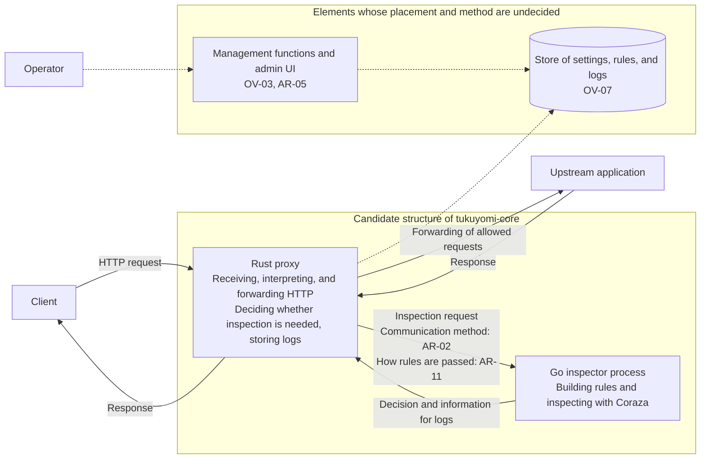
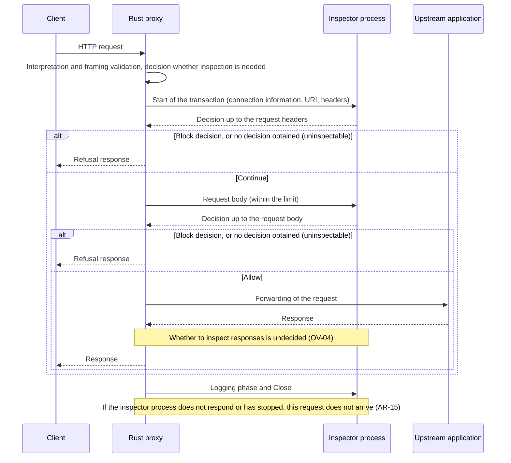

[English](architecture.md) | [日本語](architecture.ja.md)

# Architecture Overview

> **Status: initial draft**
>
> This document describes candidates for the overall structure. For the implemented scope, see "Current Status" in the [system overview](system-overview.md).
> The elements in the diagrams represent logical responsibilities. They do not settle the placement on the OS, the communication method, the libraries, the database, the ports, or the versions.

## Scope of This Document

This document covers the candidate ways to connect to the inspection engine, the division of responsibilities, the failure scope, an example request flow, the design obligations that must be decided whichever approach is chosen, the States × Operations tables, and the candidate checks needed before deciding on adoption.

The assumptions and terms are in the [system overview](system-overview.md), and the principles and the handling of inspection modes are in [design principles and constraints](design-principles.md).

## Candidate Structure

### First Candidate: a Rust Proxy and a Go Inspector

In this proposal, the Rust proxy handles receiving, interpreting, and forwarding HTTP, the configuration, and storing logs, and leaves inspection with Coraza to a small dedicated Go process.

- The proposal is for the inspector process to use the Coraza Go API directly, without libcoraza in between.
- The proposal is to give the inspector process no admin API, no connection to the store for settings and rules, no forwarding to upstreams, and no direct communication with clients.
- This proposal is the first candidate because the Rust proxy may avoid being brought down when the inspector process exits abnormally, and because it may be possible to restrict the privileges and resources of the inspection side separately. It does not guarantee that communication is never interrupted (see "Failure Scope").
- In exchange, it adds responsibilities: inter-process communication, managing start, stop, and restart by the supervisor, conveying readiness, and reclaiming resources (see "Shared Responsibilities and Those Each Approach Adds").
- Separate processes alone do not give privilege separation (see "Privilege and Resource Boundaries"). Whether to adopt this structure as a whole is decided after verification (AR-01; for its limited adoption in the initial implementation of the inspection kernel, see "Current Status" in the [system overview](system-overview.md)).

Solid lines show the main flows in the candidate structure, and dotted lines show relations whose placement or method is undecided.

### Division of Responsibilities (Candidate)

| Owner | Responsibilities (proposal) | Responsibilities not given (proposal) |
|---|---|---|
| Rust proxy | Accepting connections, TLS (whether to terminate TLS is covered by OV-06), interpreting HTTP and validating framing, deciding whether inspection is needed, building the form passed to inspection, validating the decision and the information for logs, applying the decision, forwarding to the upstream, managing the configuration, storing logs (which side writes inspection logs is covered by DP-10), and managing communication with the inspector process | Evaluating Coraza rules |
| Go inspector process | Building rules and holding generations; transactions, from creation to the logging phase (phase 5) and Close; and returning the decision and the information for logs | The admin API, a connection to the store for settings and rules (how rules are passed is covered by AR-11), forwarding to the upstream, and direct communication with clients |
| Supervisor (start, stop, restart) | Which process is responsible is undecided (AR-03) | — |
| Management functions and admin UI | The scope and placement are undecided (OV-03, AR-05) | — |

### Compared: Calling libcoraza from the Rust Proxy

In this proposal, the Rust proxy calls libcoraza (Coraza's C library), and inspection runs in the same process.

- Inspection needs no inter-process communication of its own.
- It takes on the responsibility of bridging the ownership, lifetime, borrowing, callbacks, concurrent execution, initialization failures, and error conversion of the C API safely to the Rust side, and it requires building and distributing the native library. This FFI boundary is checked for acceptance against the API to be adopted, including failure cases (see "Checks Needed for the Decision (Candidates)"). The Go runtime is also loaded into the same process.
- Both the version of the connection library and the version of Coraza included in it must be pinned, and they must be checked against the patched versions (DP-09).
- An unrecoverable failure during inspection may stop the whole process, including the Rust proxy.
- If a single process becomes mandatory (OV-06), or if the communication and operational burden of a separate process is unacceptable, this proposal is the first to be re-evaluated.

### Shared Responsibilities and Those Each Approach Adds

When comparing the approaches, count two kinds of responsibility separately: those that come from putting HTTP processing in Rust at all, and those that each approach adds. A shared responsibility does not mean the same amount of implementation or the same kinds of failure in both approaches.

| Responsibility | Shared by both approaches | Added by the separate-process proposal | Added by the libcoraza proposal |
|---|---|---|---|
| HTTP interpretation and forwarding | Framing, normalization, bodies and trailers, and the relation between the inspected form and the forwarded form | Turning the form passed to inspection into messages, and the contract between the Rust proxy and the inspector process | Converting the form passed to inspection into C API types |
| Transactions | The order of phases, lifetime, the logging phase and Close, and rule generations | Disconnection; lost, duplicated, or mixed-up messages; state mismatches between the two sides; and decisions mixed across a restart | Ownership, lifetime, and borrowing across the C API, callbacks, and error conversion |
| Bodies and resources | Limits on memory, disk, and concurrency, and the meaning of partial inspection | Copying bodies, communication flow control, queues, and reclaiming stranded requests | OS resource limits apply per process, so it is harder to restrict the inspection side alone |
| Start and update | Readiness of the WAF instance, building and switching rules, and the lifetime of old generations | Conveying the inspector process's readiness, verifying the communication peer, and managing stop and restart by the supervisor | Failures in loading and initializing the native library |
| Rules and privileges | The privileges needed for DNS queries, external commands, writing to files and audit logs, and so on | The OS privileges given to the inspector process, and distributing and operating them | The Rust proxy also holds the privileges needed for inspection |
| Build and distribution | Both the Rust and Go toolchains | Two executables, their start order, and keeping the combination of versions consistent with the communication contract (AR-13) | Building, linking, and distributing the native library |

Which approach is faster, simpler, or safer is not decided before the comparison. Using inter-process communication does not by itself make anything faster, simpler, or safer. Compare them with the same inspection scope and the same load (see "Checks Needed for the Decision (Candidates)").

## Privilege and Resource Boundaries

Separate processes alone do not give privilege separation. If the separate-process proposal is adopted, decide at least the following together (AR-03, AR-04).

- The OS user that runs the inspector process, and the files it can access. If rules refer to other files, include those files too.
- Whether external communication is allowed. Depending on the rule features, DNS queries, running external commands, and writing to files may be needed, so decide this together with which features can be used (DP-07).
- The limits on memory, CPU, disk, and concurrency, and how they are applied
- Which process starts, stops, and restarts it, and under what conditions it is restarted
- If bodies are temporarily spilled to disk: where they go, and the permissions, capacity, and reclaiming of that location (AR-09, AR-15)

The concrete OS isolation method and the deployment structure are decided together with the supported environments (OV-06).

## Failure Scope

In the separate-process proposal, if an inspector process exits abnormally or is killed, the effects are as follows (planned stops and draining are handled separately, in AR-17).

- All transactions that the process was handling are lost. This is not a way of cancelling individual requests.
- Even if the Rust proxy keeps running, communication is not necessarily uninterrupted. That process cannot inspect until it has been restarted (who restarts it is covered by AR-03) and is ready. If no other inspector process can take its place, traffic that requires inspection (DP-02) becomes uninspectable, and the proposal is to refuse it (DP-03).
- When the process is killed, the logging phase and Close are not run for its transactions, so complete recovery of inspection logs and deletion of temporary files cannot be guaranteed. The proposal is to use the information left in the Rust proxy to record, as separate cases, that the request was incomplete and that recording the log failed (DP-10). Inspection logs that cannot be recovered are not treated as completed normally. For how resources are reclaimed, see AR-15.
- If resource limits are not made explicit, an inspector process's use of CPU, memory, and disk may affect other inspector processes and the host's resources, including the Rust proxy.
- Data already sent to the upstream, and a response that has already started going to the client, cannot be taken back. How much may be sent before inspection completes is handled in AR-08.

In the libcoraza proposal, the same kind of failure may spread to the whole process, including the Rust proxy.

In either proposal, limiting the effect of failures is no substitute for using patched versions of dependencies (DP-09).

## Request Flow (Example)

The diagram shows an example for traffic that requires inspection: the Rust proxy receives the whole request body and then waits for the decision on it. The relation between the start of forwarding and the completion of inspection is undecided (AR-08). If routes with an explicit bypass are kept (DP-01), the proposal is not to call the inspector process for those routes.

## Design Obligations

The following items must be decided whichever approach is chosen. Concrete values and formats are undecided and are not defined in this document. Anything written as a "proposal" is a proposal that has not been adopted.

### HTTP Parsing and Framing (AR-06)

- Decide whether to refuse ambiguous framing (both Content-Length and Transfer-Encoding, contradictory duplicate headers, line folding, and so on) or to normalize it as far as the standards allow. The proposal is to refuse it by default.
- Decide whether to rebuild a received request when forwarding it, to prevent request smuggling.
- When refusing early, make sure that an unread body is not interpreted as the next request on the same connection. This includes the handling of `Expect: 100-continue` and connection reuse.
- In HTTP/2 and HTTP/3, cookie splitting, the relation between `:authority` and Host, and so on make the form passed to the inspection engine differ from HTTP/1.1, so rule results may change (OV-05).
- Traffic after an Upgrade (WebSocket and so on), bidirectional streams, and incrementally sent responses may not fit an approach that receives everything before evaluating it. Decide how to handle them (OV-05).
- Trailers arrive after the body, so decide whether they can be passed to the inspection engine or may be forwarded without inspection (AR-07).
- Without decompression, there is no guarantee that the plaintext of a compressed body can be inspected. Decide whether to decompress it, refuse it, or state explicitly that it is outside the inspection scope, and which encodings are covered. If decompressing, decide not only the size after decompression but also the limits on the CPU, memory, disk, and time used for decompression, the handling when a limit is exceeded or decompression fails (AR-09, AR-14), and how the inspected decompressed form corresponds to the original form that is forwarded (AR-07).
- The Rust proxy needs these in the libcoraza proposal as well.

### Inspected and Forwarded Forms (AR-07)

- If the path, query, Host, or headers are rewritten after inspection, state explicitly which rules inspect the form before the rewrite and which inspect the form after it.
- When a body is decompressed or parsed before inspection, decide how to make sure that the inspected form and the original form that is forwarded represent the same content (AR-06, AR-09).
- Make decoding and normalization run the same number of times, in the same order, in the bypass and route decision, in inspection, and in forwarding. If the decision and forwarding interpret a request differently, requests may slip past the decision.
- A request whose need for inspection or whose route cannot be determined (the URI or Host cannot be interpreted, normalization results disagree, and so on) is not treated as a bypass. How it is handled is covered by DP-03.
- Some rewriting for routing is intentional, so "make all forms identical" is not enough as a specification.

### Body Parsing, Limits and Partial Inspection (AR-09)

- Passing a body to the inspection engine does not by itself mean that the arguments and so on in it were parsed and inspected. Make the following part of the specification and the acceptance conditions: which body processor (the way the body is parsed) is selected for each Content-Type in the adopted scope, what is inspected in requests and in responses (when responses are inspected, OV-04), and how bodies with an unknown, unsupported, or invalid Content-Type are handled. The formats and values to adopt are undecided.
- Decide the limit on the whole inspected body and the limit on what is held in memory (beyond which the excess spills to disk) separately. Whether the spill destination can be specified is checked against the version to be adopted.
- Partial inspection, which lets the part beyond the limit through uninspected, is not compatible with fail-closed for traffic that requires inspection, so decide where partial inspection is allowed.
- Limits such as the number of arguments may make the inspection engine drop part of the input without inspecting it. For blocking mode, make it an acceptance condition that settings and rules detect when a limit is reached and refuse the request.
- Check how body parsing errors, URI parsing errors, and strict multipart validation failures are handled for each combination of engine, settings, and rules.
- The inspection engine's recommended settings are used as a reference, not adopted as the product specification as they stand. Their initial values may include non-blocking behavior and partial inspection.
- Decide the limits on concurrency and queues, and the response when they are full (AR-16).
- Decide the limits of the WAF instance (such as the body and arguments passed to the inspection engine) separately from the limits when the Rust proxy receives and forwards (connections, headers, bodies, concurrency, queues, timeouts). Whichever of On, DetectionOnly, Off, and explicit bypass is adopted, the proposal is that the Rust proxy should have bounds on resources and time when it receives and forwards. The values, and the handling when they are exceeded, are undecided.
- Distinguish a transaction already assigned to an inspector process from a request still waiting in the queue. Decide who owns the resources held while it waits (held bodies, connections) and the concurrency slot, and how they are handed over at assignment. A request cancelled by a disconnection or a timeout is not assigned afterwards (see the table "Requests Waiting for Assignment").

### Transaction Phases, Lifetime, Logging and Close (AR-10)

- For each adopted inspection scope and route, define which phases are called, and in what order, as a call contract between the Rust proxy and the inspection engine (the inspector process in the separate-process proposal). The proposal is to treat out-of-order, missing, and duplicate calls that break the contract as uninspectable, rather than relying only on the inspection engine's warnings.
- In the contract, distinguish the following from an improper omission: not calling the remaining phases after an early block, not calling the response phases when responses are not inspected (OV-04), and a rule action that intentionally ends evaluation (whether to adopt that feature is covered by DP-07).
- Decide when a transaction starts (when the request is accepted, or when it is assigned to the inspector process). For the handling of waiting requests, see AR-09.
- Pass connection information (the client address, the server name, and so on) to the inspection engine. Decide what to pass and where the values come from (DP-08).
- When returning a block decision to the Rust proxy, include not only the status but also the kind of action (deny, redirect, drop, and so on) and the information that comes with it.
- Decide which element runs the logging phase and Close, and when, for every one of these cases: block, allow, uninspectable, client disconnection, timeout, and upstream failure. Without Close, temporary body files and transaction resources are left behind.
- It is undecided whether the inspector process writes inspection logs (audit logs) directly, or returns the information for logs to the Rust proxy, which writes them (DP-10, AR-04).
- When responses are inspected (OV-04), keep the transaction until the decision on the response.

### Consistency of Rule Generations (AR-11)

- Do not assume that the inspection engine can replace rules in use. The proposal is to build a new WAF instance and then switch the reference to it. This proposal needs no restart of the inspector process to switch rules, but compare it with the proposal to switch by restarting, and then decide (AR-17).
- A transaction is inspected to the end with the generation in use when it started. Decide when to switch to a new generation, when the old generation can be released, and how updates are serialized.
- If building the new generation fails before switching and the current WAF instance is healthy, the proposal is to keep using the current generation. Check that the failure is recorded and that the resources of the failed build are reclaimed. This includes the resource limit when invalid rules are validated repeatedly.
- If the inspector process exits abnormally during an update, all of its transactions are lost (see "Failure Scope"). If the switch happened but the notification of the result was lost, or the update timed out, it is not possible to conclude either that the update failed or that the old generation is still in use. Decide how to confirm which generation was actually applied, how to retry, and how to keep generations consistent after a restart (AR-13).
- Decide which generation is used to inspect requests in the queue (locked in when the request is accepted, or when it is assigned).
- If multiple rule sets are kept (for example, a default and per-route ones), decide how the generations of each stay consistent and how to handle a chosen rule set that cannot be used (DP-04).
- Decide how rules reach the inspector process (the Rust proxy passes them, or the inspector process reads them) together with its privileges (AR-04). If the inspector process reads them, decide how that fits with the proposal to give it no connection to the store, and which files it can read.
- In the separate-process proposal, the proposal is that the Rust proxy should be able to confirm which generation a decision was made with.

### Start and Readiness (AR-12)

- With a separate process, there may be a period when the Rust proxy has started accepting requests but the inspector process has not finished building its rules. Decide how the start of accepting relates to readiness.
- Decide how readiness is conveyed and how to confirm readiness after a restart. Include a per-start identifier in the readiness notification too, so that it is not mistaken for a notification from a previous start (AR-13).
- Decide how readiness as seen from outside (health checks, load balancing, and so on) is tied to the state of the inspector process.
- If building the initial rules fails, decide whether to abort the start or to wait while refusing traffic that requires inspection.
- Failures of rule updates are handled in AR-11.

### Messages Between Processes (AR-02, AR-13)

- Design on the assumption that bytes sent by an attacker end up in messages. The proposal is to use a format whose boundaries and lengths can be validated, set a limit for each kind of message, and treat anything over the limit as uninspectable.
- The proposal is that the Rust proxy should assign the internal transaction identifiers. A request ID sent by the client (`X-Request-ID` and so on) is not used as it is, and external correlation information is kept separate from the internal identifier.
- The proposal is for messages to carry per-start identifiers of both the Rust proxy and the inspector process, so that decisions from before and after a restart do not mix. The proposal is to discard decisions that carry the identifier of a previous start, late decisions for requests that have ended or been cancelled, and duplicate decisions, without making the current transaction uninspectable for that reason alone.
- For an anomaly in an individual message that can be correlated (an invalid type, length, or range, or an ordering violation in that transaction), the proposal is to make only that transaction uninspectable. If the shared connection is cut, or message boundaries are broken so that nothing after them can be trusted, all transactions in progress on that connection are affected.
- The proposal is to include a per-start identifier and the update correlation in readiness notifications and update result notifications too (AR-11, AR-12).
- The decisions and information for logs that the inspector process returns are also validated for type, length, and range in the Rust proxy (DP-10).
- Decide how to verify the communication peer in both directions. The inspector process, too, rejects requests from an unexpected source. The method is decided together with the communication method.
- Decide how to keep the versions of the two executables consistent with the communication contract and capabilities: for example, detect a combination that does not match and reject it, or distribute only combinations known to match (OV-06, DP-09). Whether to adopt staged updates, or to make them mandatory, is not decided.
- The communication method and the message format are undecided (AR-02). A Unix domain socket on the same host is one candidate, not a requirement.

### Timeouts and Actual Cancellation (AR-14)

- Decide each kind of timeout separately. There are at least these: receiving from the client (including slow sending), sending to the client, keeping idle connections open, waiting in the queue, decompressing bodies, connecting to and getting a response from the upstream, waiting for the inspection decision, and draining. The values are undecided.
- Even if the Rust proxy stops waiting because of a timeout, the inspector process does not necessarily stop evaluating. There is no guarantee that rule evaluation can be interrupted partway through.
- Decide the per-request timeout separately from the amount of work that actually remains in the inspector process (the concurrency limit), and decide when the concurrency slot is returned.
- The proposal is to refuse traffic that requires inspection as uninspectable when it times out, and to discard decisions that arrive after the timeout (AR-13).
- A forced restart is no substitute for cancelling individual requests, because the other transactions of the same process are lost too. The conditions for forcibly restarting an unresponsive inspector process are covered by AR-03.

### Reclaiming Resources (AR-15)

- Normally, and for transactions that finish before the timeout during a planned stop or drain, the logging phase and Close reclaim the resources. Transactions stopped after the drain timeout may be handled the same way as an abnormal exit (AR-17).
- Close is not run when an inspector process is killed. The proposal is to give each inspector process its own temporary area, tie it to the identifier of that start and to its owner, and reclaim it after confirming that the owner process has exited. Resources of a process that is still running, or of another transaction, are not deleted. What to do when the old process is still running, or its exit cannot be confirmed, is undecided.
- For the handling of inspection logs that could not be reclaimed, see "Failure Scope" and DP-10.
- If the Rust proxy exits abnormally, the proposal is that the inspector process should detect that it has lost its peer and close the incomplete transactions.
- The Rust proxy also reclaims what is left stranded on its side, such as a pending wait for a decision or a concurrency slot.

### Stopping and Configuration Reload (AR-17)

- For a planned stop of an inspector process (to update it, and so on; whether switching rules needs a restart is covered by AR-11), the proposal is to assign it no new transactions, wait for those in progress up to the timeout, and then run the logging phase and Close. This is handled separately from an abnormal exit.
- For when the Rust proxy stops and when it reloads the configuration, decide how to handle requests in progress, requests in the queue, notifying the inspector process, and logs. Also decide when the configuration used to decide whether inspection is needed is locked in and held (when the request is accepted, or when it is assigned). If a configuration reload fails, the proposal is to keep using the current configuration.

### Upstream Failures (AR-18)

- Run the transaction's logging phase and Close in these cases too: a failed connection to the upstream, a timeout, a disconnection, and an invalid response.
- The proposal is to record an upstream failure as its own reason, separate from a block and from uninspectable.
- The response returned to the client is handled in AR-16. Whether to resend the same request to the upstream is undecided, along with the inspection scope.

## States × Operations

The tables in this section assume the separate-process proposal and traffic that requires inspection, with the WAF instance in On mode. For DetectionOnly, Off, explicit bypass, and a failure of rule selection, see the table in [design principles and constraints](design-principles.md). In the libcoraza proposal, the inspector process rows are replaced by the state of the whole process, including the Rust proxy.

How to read the tables:

- Every statement in the tables is a candidate that has not been adopted, not implemented behavior. What the initial implementation of the inspection kernel implements is described separately from these tables; see "Current Status" in the [system overview](system-overview.md).
- "Proposal" marks the items where other options are especially plausible, and an ID points to a detail that is undecided. A statement with neither a proposal nor an ID is a property that must hold whichever approach is chosen (a candidate requirement).
- "New requests" are requests that arrive during that state, and "transactions in progress" are those already assigned to an inspector process. Requests in the queue before assignment have their own table, "Requests Waiting for Assignment".
- The column "Explicit bypass requests" applies only if bypass is kept (DP-01).
- In the column "Returning the response", once the response has started, the status can no longer be changed, and the only options left are to abort it or cut it off partway through (AR-08).

### Inspector Processes and Inter-Process Communication

| State | New requests that require inspection | Transactions in progress | Explicit bypass requests (if kept) | Returning the response | Rule update |
|---|---|---|---|---|---|
| Starting (before ready) | Not assigned. If no other inspector process is ready, the proposal is to refuse the request as uninspectable. How this relates to the start of accepting is covered by AR-12 | None | Whether to let them through without waiting for the inspector process to be ready is covered by DP-01 and AR-12 | — | How a failure to build the initial rules is handled is covered by AR-12 |
| Ready | Inspected with the generation in use when the transaction starts. How a block decision relates to the start of forwarding is covered by AR-08 | Processes the phases in the contract in order, and is responsible through the logging phase and Close (AR-10) | The proposal is not to call the inspector process. The reason inspection was skipped is recorded (DP-01, DP-05) | Whether to inspect responses is covered by OV-04 | The proposal is to validate and build a new generation, and to switch to it starting with new transactions (AR-11) |
| Planned stop or drain | Not assigned to the process being stopped. If no other process can take over, the proposal is to refuse the request as uninspectable | The proposal is to wait for them to complete, up to the timeout, and to run the logging phase and Close. For those still running after the timeout, see AR-17 | The proposal is that they are not affected | After sending has started, see AR-08 | Whether to accept updates during the stop is covered by AR-17 |
| Abnormal exit or forced exit | That process cannot inspect until it has been restarted (who restarts it is covered by AR-03) and is ready. If no other process can take over, the proposal is to refuse the request as uninspectable. The response to return is covered by AR-16 | All of that process's transactions are lost. The proposal is to refuse requests not yet forwarded. Data already forwarded cannot be taken back. The logging phase and Close are not run, and the proposal is to record the transactions as incomplete (AR-15, DP-10) | The proposal is that they see no direct effect, because the inspector process is not used. The effect on host resources is a separate matter (AR-04) | When responses are inspected, the proposal is to stop the response if sending has not started. After sending has started, see AR-08 | The result of an update in progress cannot be confirmed. Which generation to build after a restart is covered by AR-11 |
| Not responding (not stopped) | If the wait for a decision times out, the proposal is to refuse the request as uninspectable (AR-14). Whether to keep assigning new transactions is covered by AR-03 | Even after the wait stops, work may remain in the inspector process. The condition for a forced restart is covered by AR-03 and AR-14 | The proposal is that they are not affected | After sending has started, see AR-08 | The update timeout, and the handling when the result is unknown, are covered by AR-11 |
| Restarting (before readiness is confirmed) | Not assigned until readiness is confirmed. If no other process can take over, the proposal is to refuse the request (AR-12) | The proposal is to discard decisions that carry the identifier of a previous start (AR-13) | The proposal is that they are not affected | — | Which generation to build at restart, and how updates are retried, are covered by AR-11 |
| Anomaly in an individual message that can be correlated (an invalid type, length, or range, or an ordering violation in that transaction) | No effect | The proposal is to make only that transaction uninspectable (AR-13) | — | After sending has started, see AR-08 | The proposal is to treat an anomaly in an update message as an update with an unknown result (AR-11) |
| Shared connection cut, broken message boundaries, or failed peer verification | Not assigned until the connection is re-established and readiness is confirmed. If no other process can take over, the proposal is to refuse the request as uninspectable | The proposal is to make all transactions in progress on that connection uninspectable (AR-02, AR-13) | — | After sending has started, see AR-08 | The result of an update in progress becomes unknown. For how to confirm the applied generation, see AR-11 and AR-13 |
| Stale decisions (an identifier of a previous start, late decisions for requests that have ended or been cancelled, duplicates) | No effect | Discarded. The proposal is not to make the current transaction uninspectable for that reason alone (AR-13) | — | — | The proposal is to discard the result notification of an old update too (AR-13) |

### Requests, Resources, Upstreams and Logs

| State | New requests that require inspection | Transactions in progress | Explicit bypass requests (if kept) | Returning the response | Rule update |
|---|---|---|---|---|---|
| Timeout (the kinds of timeout are covered by AR-14) | The proposal is to refuse the request as uninspectable | Even after the wait stops, the inspector process may go on evaluating. The proposal is to discard decisions that arrive after the timeout (AR-13). When the concurrency slot is returned is covered by AR-14 | Forwarding timeouts are covered by AR-14 | After sending has started, see AR-08 | Update timeouts are covered by AR-11 |
| Client disconnection (before forwarding starts) | Not forwarded. The logging phase and Close are run (AR-10) | Same | Not forwarded | — | — |
| Client disconnection (after forwarding starts) | — | Whether to abort forwarding to the upstream is covered by AR-08. The logging phase and Close are run (AR-10) | Whether to abort forwarding to the upstream is covered by AR-08 | Stop returning the response and release resources (AR-10) | — |
| Body or argument limit exceeded | The values and the conditions for refusal are covered by AR-09. Partial inspection, which forwards the uninspected remainder, is not compatible with fail-closed for traffic that requires inspection | The proposal is to make a transaction that reached the limit uninspectable. Input that the inspection engine dropped is detected and refused (AR-09) | The proposal is that the Rust proxy should have limits when it receives and forwards. The values, and the handling when they are exceeded, are covered by AR-09 | Limits on response bodies are covered by OV-04 and AR-09 | — |
| Concurrency or queue limit exceeded | The proposal is to refuse the request without creating a transaction. The limit values are covered by AR-09, and the response to return in AR-16 | The proposal is that they are not affected | The proposal is that the Rust proxy should have concurrency limits on its side. The values, and the handling when they are exceeded, are covered by AR-09 | — | Limits on the resources used to build rules are covered by AR-11 |
| Out of disk space, or a problem with the spill destination | The proposal is to refuse a request that needs to spill as uninspectable (AR-09) | The proposal is to make a transaction that is spilling uninspectable. For the effect on other processing, including the Rust proxy, see AR-04 | For the scope of the effect, see AR-04 | After sending has started, see AR-08 | — |
| Upstream failure (failed connection, timeout, disconnection, invalid response) | Occurs after inspection. The response to return is covered by AR-16 | The logging phase and Close are run. The proposal is to record it as a reason separate from a block or uninspectable (AR-18) | Handled the same way (AR-18) | After sending has started, see AR-08 | — |
| Failure of the log store (full or unavailable) | Whether to keep forwarding when logs cannot be recorded is covered by DP-10 | Same | Same | — | How update logs are recorded is also covered by DP-10 |

### Requests Waiting for Assignment

This table covers requests that require inspection while they wait in the queue, after being accepted and before being assigned to an inspector process. For who owns the resources held while waiting and the concurrency slot, and how they are handed over at assignment, see AR-09.

| State | Handling of waiting requests (candidate) |
|---|---|
| Client disconnection | Removed from the queue, and its resources are released. Not assigned afterwards |
| Wait timeout (AR-14) | The proposal is to remove it from the queue and refuse it as uninspectable (AR-16). Not assigned afterwards |
| Planned stop or drain of an inspector process that is a candidate for assignment | Not assigned to the process being stopped. Whether to send it to another inspector process or refuse it is covered by AR-17 |
| Abnormal exit of the inspector process, no response from it, or a cut shared connection | Waiting requests are not lost yet. Whether to send them to another inspector process, keep them waiting, or refuse them is covered by AR-03 and AR-14 |
| Rule update | Which generation inspects them (locked in when the request is accepted, or when it is assigned) is covered by AR-11 |
| When the Rust proxy reloads the configuration | For when to lock in and hold the configuration used to decide whether inspection is needed, see AR-17 |
| Planned stop of the Rust proxy | Whether to assign or refuse the waiting requests is covered by AR-17 |

### Rules and the Rust Proxy

| State | New requests that require inspection | Transactions in progress | Explicit bypass requests (if kept) | Returning the response | Rule update |
|---|---|---|---|---|---|
| During a rule update | Inspected with exactly one generation, either the old or the new. Generations are not mixed (AR-11) | Inspected to the end with the generation in use when it started | — | A transaction uses the same generation throughout | How updates that arrive at the same time are serialized is covered by AR-11 |
| Failure of a rule update (a build failure before switching, with the current WAF instance healthy) | The proposal is to keep using the current generation | The proposal is that they are not affected | — | — | The failure is recorded, and the resources of the failed build are reclaimed. How the operator is notified is covered by OV-03 and AR-05 |
| Unknown result of a rule update (lost notification of the switch result, timeout) | The proposal is to confirm, for each decision, which generation it was inspected with (AR-11, AR-13) | Inspected to the end with the generation in use when it started | — | — | No conclusion is drawn that the update failed or that the old generation is still in use. Confirming the applied generation and retrying are covered by AR-11 and AR-13 |
| While the Rust proxy is starting | The conditions for starting to accept requests, and readiness as seen from outside, are covered by AR-12 | None | Whether to let them through without waiting for the inspector process to be ready is covered by DP-01 and AR-12 | — | How rules are built at start is covered by AR-11 and AR-12 |
| Planned stop of the Rust proxy | The proposal is to stop accepting requests | The timeout for waiting for completion, notifying the inspector process, and the logging phase and Close are covered by AR-17 | How those in progress are handled is covered by AR-17 | After sending has started, see AR-08 | The proposal is to reject updates during the stop |
| Abnormal exit or restart of the Rust proxy | Requests cannot be accepted until it has restarted and is ready (AR-12) | Requests being forwarded are lost. The proposal is that the inspector process should detect that it has lost its peer and close the transactions left in it (AR-15). They are not mixed up with requests from the previous Rust proxy (AR-13) | Requests being forwarded are lost | A response being returned is cut off | The result of an update in progress becomes unknown. The applied generation is confirmed after the restart (AR-11, AR-13) |
| When the Rust proxy reloads the configuration | For each request, whether inspection is needed is decided with exactly one configuration, either the one before the reload or the one after (AR-17) | The proposal is to handle them to the end with the configuration in use when they started | A change to the bypass settings is handled the same way (AR-17, DP-01) | The proposal is to handle it with the configuration in use when it started | Keeping the configuration consistent with the rule generations is covered by AR-11 and AR-17 |
| When the Rust proxy fails to reload the configuration | The proposal is to keep using the current configuration (AR-17) | The proposal is that they are not affected | Same | — | The failure is recorded. How the operator is notified is covered by OV-03 and AR-05 |

## Checks Needed for the Decision (Candidates)

The conditions and tolerances for the comparison are decided before verification. The versions of the dependencies and rules used in verification are checked as described in DP-09.

1. Ordinary requests and bodies reach the upstream correctly, and representative detections in the URI, headers, query, and body match those of the Coraza Go API used directly. Blocking at the request header stage is also checked. This match does not prove that the adopted inspection scope is met, so treat the inspection targets for each Content-Type and body processor (AR-09) as the specification, and check against it too.
2. When responses are inspected (OV-04), check blocking on responses and the lifetime of the transaction.
3. When the inspector process stops, communication breaks, a timeout occurs, or a client disconnects, traffic that requires inspection does not pass uninspected, and no waiting state or concurrency slot is left stranded on the Rust proxy side.
4. Out-of-order, missing, or duplicate phase calls that break the call contract are treated as uninspectable, and phases that the contract allows to be skipped, such as those after an early block, are not mistaken for uninspectable. An anomaly in an individual message that can be correlated makes only that transaction uninspectable, a cut shared connection or broken boundaries make all transactions on that connection uninspectable, and stale decisions are discarded without affecting the current transactions.
5. Stop the inspector process while several transactions are in progress. In a planned stop or drain, the logging phase and Close complete for the transactions that finish before the timeout. In an abnormal or forced exit, decisions are not mixed up; the information left in the Rust proxy can be used to record, as separate cases, that a request was incomplete and that recording its log failed; and resources and temporary files can be reclaimed without deleting those of a process that is still running. Complete recovery of logs is not required, but logs that cannot be recovered are not treated as completed normally.
6. Use a mechanism that deliberately makes the inspector process exit abnormally to check how far the Rust proxy and other requests are affected.
7. At the boundaries of body size, decompression, concurrency, queues, and slow sending, the use of memory, CPU, queues, and disk stays within the decided limits. A waiting request that was cancelled is not assigned afterwards.
8. A request that reached the limit on the number of arguments, a body that cannot be parsed, a multipart body that failed strict validation, and a body with an unknown or unsupported Content-Type are handled as decided in blocking mode.
9. During a rule update, after a build failure before switching, and after an update with an unknown result (lost notification, timeout), generations are not mixed, the applied generation can be confirmed, and the resources of the failed build are reclaimed.
10. The results distinguish the fallback after a rule selection failure from explicit bypass, DetectionOnly, and Off.
11. Inspection, the bypass decision, and forwarding do not interpret the form differently. This includes how the form inspected after decompression and parsing corresponds to the forwarded form.
12. Compare the latency, throughput, memory, and build, distribution, and operational burden of each proposal with the same rules, bodies, and load. Record both the Coraza version on the side that uses the Go API directly and the Coraza version included in libcoraza, make them part of the comparison conditions, and make them the same if possible. If they cannot be made the same, do not conclude that the difference comes only from the connection method (DP-09).
13. Log output does not become a way to leak sensitive data, or a way to inject input into whatever views and analyzes the logs (DP-10).
14. In the libcoraza proposal, check ownership, lifetime, borrowing, callbacks, concurrent execution, initialization failures, and error conversion against the API to be adopted, including failure cases. Do not limit the comparison to the failure scope within the same process.

In the libcoraza proposal, items 3, 5, and 6 are checked with the whole process as the range that the same failure reaches.

## Open Points

| ID | Item | Current handling | Related |
|---|---|---|---|
| AR-01 | How to connect to the inspection engine | The first candidate is the Go inspector process, compared against libcoraza. The Go inspector process structure was adopted only for the initial implementation of the inspection kernel (see "Current Status" in the [system overview](system-overview.md)). Adoption as a whole is decided after verification, including the comparison with libcoraza | OV-06, DP-09 |
| AR-02 | Inter-process communication method and message format (in the separate-process proposal) | Undecided. A Unix domain socket on the same host is one candidate | AR-13 |
| AR-03 | The number of inspector processes, the supervisor (who owns start, stop, and restart), and the restart conditions | Undecided | OV-06, AR-14, AR-17 |
| AR-04 | The privileges of the inspector process and the limits on OS resources | Undecided | OV-06, DP-07 |
| AR-05 | Where the management functions go (which process holds the entry point for administration) and, if they are adopted, authentication, how privileges are divided per operation, and the history and scope of changes | Undecided | OV-03, OV-07, DP-10 |
| AR-06 | Invariants of HTTP interpretation and framing, and the input to refuse or normalize | Undecided. The proposal is to refuse by default | OV-05 |
| AR-07 | Correspondence between the inspected form and the forwarded form | Undecided | OV-01, DP-05 |
| AR-08 | The relation between the start of forwarding and the completion of inspection (how much of the body is received before sending), and the handling after the response has started | Undecided | OV-04, OV-05 |
| AR-09 | Body parsing and inspection targets (for each Content-Type), the limits on body, decompression, arguments, concurrency, queues, and spilling to disk and the handling when they are exceeded (the WAF instance's limits and the Rust proxy's limits are kept separate), and the resources and slots of waiting requests | Undecided | AR-16, DP-03, OV-04 |
| AR-10 | When a transaction starts, the phase call contract for each route, and responsibility for lifetime, log recording, and Close | Undecided | AR-15, DP-07, DP-08, DP-10, OV-04 |
| AR-11 | Switching rule generations, the lifetime of old generations, serialization of updates, the handling on failure and when the result is unknown (confirmation and retries), how rules are passed, and which generation waiting requests use | Undecided | OV-07, AR-04, AR-13, DP-04 |
| AR-12 | How start, readiness, and the start of accepting relate, and readiness as seen from outside | Undecided | AR-03 |
| AR-13 | Message boundaries, lengths, and limits; correlation; per-start identifiers on both sides; distinguishing individual anomalies from anomalies of the whole connection; correlation of readiness and update result notifications; verification of the communication peer; and consistency between the versions of the two executables and the communication contract | Undecided | AR-02, AR-11, AR-12, OV-06, DP-09 |
| AR-14 | The kinds of timeouts (including decompression and waiting in the queue) and their values, and the handling after a timeout | Undecided | AR-03, AR-09 |
| AR-15 | Reclaiming resources after an abnormal exit (on both the inspector process side and the Rust proxy side; who owns what is reclaimed; confirming the exit) | Undecided | AR-03, AR-10, DP-10 |
| AR-16 | The response returned to the client on a refusal, an uninspectable request, or an upstream failure | Undecided | DP-03, AR-18 |
| AR-17 | Planned stop and drain, stopping the Rust proxy and reloading the configuration (including failures), the handling of waiting requests, and when the configuration is locked in | Undecided | AR-03, AR-11, OV-06 |
| AR-18 | The handling and recording of upstream failures (failed connection, timeout, disconnection, invalid response) | Undecided | AR-16, DP-10 |

## Related Documents

- [System Overview](system-overview.md)
- [Design Principles and Constraints](design-principles.md)
- [Documentation Index](../../README.md)
